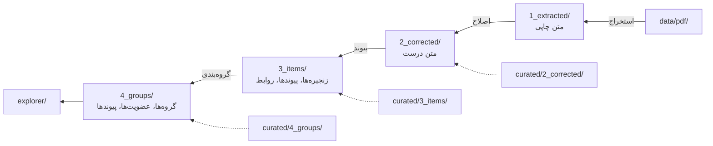

# مشارکت

نیازمند Python 3.11 یا بالاتر و [uv](https://docs.astral.sh/uv/).

## مراحل کار {#the-pipeline}



`output/1_extracted/` هر PDF را دقیقاً، حتی با غلط‌های تایپی‌اش، بازتولید می‌کند
تا معلوم شود با تغییر استخراج‌گر یا جایگزینی یک PDF چه چیزی عوض می‌شود. هر
انحراف از متن چاپی یک سطر در `curated/` است که برای ساختن `output/2_corrected/`
(با همان ستون‌ها) اعمال می‌شود. `output/` در git نگه داشته می‌شود تا هر تغییر به
صورت تفاوت (diff) دیده شود، و وقتی مرحله‌ای به‌روز نباشد آزمون‌ها شکست می‌خورند؛
GitHub این فایل‌ها را در نمایش تفاوت‌ها جمع می‌کند (`.gitattributes`).

```bash
uv run hiesir-codebook build                 # regenerate every stage of output/
uv run hiesir-codebook build --no-extract    # keep 1_extracted/ (no PDFs needed)
uv run hiesir-codebook all                   # just extract: PDFs -> output/1_extracted/
uv run hiesir-codebook 1382 1403             # or just some years
uv run python -m hiesir_codebook.correction.correct --check   # correct and check against the raw data
uv run python -m hiesir_codebook.extraction.validate    # check extracted codes against the raw data
uv run python -m hiesir_codebook.explorer    # just the explorer page
```

## اصلاح داده‌ها {#fixing-the-data}

هرگز `output/` را ویرایش نکنید. هر تغییری در `curated/` می‌رود، هر تصمیم در یک
سطر و همراه با دلیلش:

| فایل | چه چیزی را اصلاح می‌کند | اعمال توسط |
|---|---|---|
| `2_corrected/corrections.csv` | تک‌قلم‌ها و سرگروه‌ها در یک سال: کد نادرست، متن نادرست، بخش جاافتاده | `correct` |
| `2_corrected/spelling.csv` | املاهایی که در سطرها و سال‌ها تکرار می‌شوند: غلط تایپی، واژه‌های چسبیده، نیم‌فاصله | `correct` |
| `2_corrected/spelling_suggestions.csv` | تصمیم درباره پیشنهادهای املایی hazm (`find`): تأیید، رد، تغییر | `correct` |
| `3_items/links.csv` | تصمیم درباره پیوند یک‌به‌یک میان زنجیره‌ها (`from_chain` ← `to_chain`، همان قلم یا تغییر کد): تأیید، رد، تغییر، افزودن | `relations` |
| `3_items/relations.csv` | تصمیم درباره ادغام، تفکیک و بازگروه‌بندی میان مجموعه زنجیره‌ها (`from_chains` ← `to_chains`): تأیید، رد، تغییر، افزودن | `relations` |
| `4_groups/links.csv` | تصمیم درباره پیوند میان سرگروه‌ها (`from_group` ← `to_group`: ادامه، تفکیک، ادغام، بازگروه‌بندی، جابه‌جایی): تأیید، رد، تغییر، افزودن | `groups` |

ستون‌های هر فایل در [روش کار](methods.md) آمده‌اند: [اصلاحات](methods.md#corrections)
و [تصمیم‌های پیوند](methods.md#matching-items-across-years). پس از ویرایش،
`uv run hiesir-codebook build --no-extract` را اجرا کنید و تفاوت‌ها را در
`output/` بازبینی کنید.

پس از تغییر اصلاحات یا `spelling.csv`، پیشنهادهای املایی را از واژه‌نامه hazm
دوباره بسازید (hazm به پایتون ۳.۱۲ یا ۳.۱۳ نیاز دارد)، سطرهای `apply` برابر `no`
را بازبینی کنید و هر پیشنهادی را در `curated/2_corrected/spelling_suggestions.csv`
بازنویسی کنید:

```bash
uv run --python 3.13 --extra hazm python -m hiesir_codebook.correction.spelling   # -> output/2_corrected/spelling_suggestions.csv
uv run --python 3.13 --extra hazm python -m hiesir_codebook.correction.check      # -> reports/label_check.csv (to review)
```

## آزمون‌ها {#tests}

```bash
uv run pytest                 # unit tests + regression against output/1_extracted/ (needs data/)
uv run pytest -m "not slow"   # unit tests only
uv run ruff check . && uv run ruff format --check .
```

آزمون‌های رگرسیون همه سال‌ها را دوباره استخراج و بایت‌به‌بایت با
`output/1_extracted/` مقایسه می‌کنند. وقتی تغییری در استخراج‌گر عمدی است، با
`uv run hiesir-codebook all` دوباره بسازید و پیش از commit تفاوت‌های CSV را
بازبینی کنید. آزمون‌های سریع هم بررسی می‌کنند که `output/2_corrected/`،
`output/3_items/`، `output/4_groups/` و `output/explorer/` به‌روز باشند؛ پس از تغییر `curated/` یا
کد، `uv run hiesir-codebook build --no-extract` را اجرا و تفاوت‌ها را بازبینی
کنید. آزمون‌هایی که به `data/` (خارج از git) نیاز دارند، وقتی این پوشه نباشد، مانند
GitHub، رد می‌شوند.

## مستندات {#documentation}

این سایت با [Material for MkDocs](https://squidfunk.github.io/mkdocs-material/) از
`docs/` و `mkdocs.yml` ساخته می‌شود. جست‌وجوی اقلام و فایل‌های CSV هنگام ساخت از
`output/` افزوده می‌شوند (`scripts/mkdocs_hooks.py`)، پس هرگز در git تکرار
نمی‌شوند.

جست‌وجوی اقلام یک جزء واحد در `src/hiesir_codebook/data/explorer/` است:
`explorer.js`، `explorer.css` و `strings.js` با متن‌های انگلیسی و فارسی. صفحه
`docs/explorer.md` (و `explorer.fa.md`) آن را از طریق `overrides/explorer.html`
درون سایت نشان می‌دهد و رنگ، قلم و حالت تیره سایت را می‌گیرد؛ فایل آفلاین
`output/explorer/index.html` همین سه فایل را درون خود دارد (`standalone.html`).
جزء را یک بار تغییر دهید تا هر دو به‌روز شوند.

نمودارها با [Mermaid](https://mermaid.js.org/) در یک بلوک کد ` ```mermaid `
نوشته می‌شوند تا متنی بمانند و حالت روشن یا تیره سایت را بگیرند. در صفحه فارسی
از `flowchart RL` استفاده کنید تا جریان از راست به چپ خوانده شود.

هیچ عددی دستی در صفحه نوشته نمی‌شود: نام یکی از اعداد `output/metrics.json` را
میان دو آکولاد دوتایی بنویسید، مثلاً `links.confirmed`، تا ساخت سایت عدد را
(در صفحه‌های فارسی با رقم‌های فارسی) جایش بگذارد. هر ساخت این فایل را از نو
می‌نویسد، پس تفاوت آن نشان می‌دهد هر تغییر چه کرد؛ نام ناشناخته ساخت سایت را
متوقف می‌کند و یک آزمون را شکست می‌دهد.

هر صفحه دو نسخه دارد: `page.md` (انگلیسی) و `page.fa.md` (فارسی، در نشانی
`/fa/`). اگر نسخه فارسی صفحه‌ای نباشد، نسخه انگلیسی نشان داده می‌شود. وقتی یک
صفحه را تغییر می‌دهید، نسخه دیگرش را هم به‌روز کنید؛ عنوان‌ها شناسه ثابت انگلیسی
دارند (`## اصلاحات {#corrections}`) تا پیوندها در هر دو زبان کار کنند.

```bash
uv run --group docs mkdocs serve      # preview at http://127.0.0.1:8000, reloads on save
uv run --group docs mkdocs build --strict   # what GitHub runs: fails on broken links
```

هر push به `main` آزمون‌ها را اجرا و سایت را در GitHub Pages منتشر می‌کند
(`.github/workflows/pages.yml`).

## فایل‌های PDF پرسشنامه {#questionnaire-pdfs}

فایل‌های PDF در git نیستند: به انتشار
[`questionnaires`](https://github.com/Open-Data-for-Iran/HIESIR-Codebook/releases/tag/questionnaires)
در GitHub پیوست شده‌اند و هر بار ساخت سایت آن‌ها را دریافت و در `pdf/` منتشر
می‌کند؛ در صفحه [پرسشنامه‌ها](questionnaires.md) فهرست شده‌اند و هر قلم در جست‌وجوی
اقلام به آن‌ها پیوند دارد. برای افزودن یا جایگزینی یک فایل، آن را در `data/pdf/`
بگذارید، سپس

```bash
uv run python -m hiesir_codebook.extraction.pdfs stage   # data/pdf -> data/release, renamed questionnaire_<year>[_urban|_rural].pdf
```

را اجرا کنید و فایل را از `data/release/` به انتشار بارگذاری کنید (Edit release و
پیوست فایل). برای انتشار، workflow مستندات را دوباره اجرا کنید. ساخت محلی از
`data/release/` یا `data/pdf/` (اگر باشند) یا پوشه `$HIESIR_PDF_DIR` استفاده می‌کند.

## مجوز {#license}

MIT؛ فایل `LICENSE` را در مخزن ببینید.
