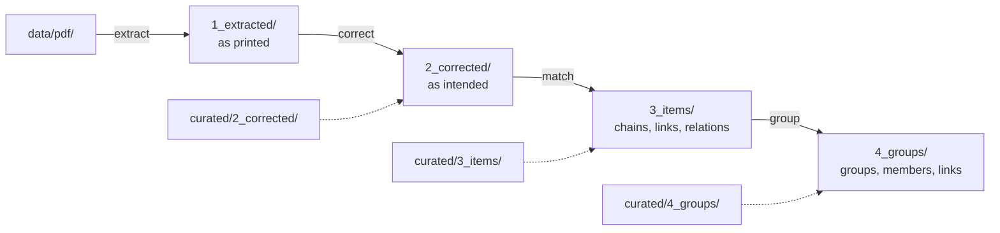

# Contributing

Requires Python 3.11+ and [uv](https://docs.astral.sh/uv/).

## The pipeline



`output/1_extracted/` reproduces each PDF exactly, typos included, so it
shows what changes when the extractor changes or a PDF is replaced. Every
deviation from the print is a row in `curated/`, applied to produce
`output/2_corrected/`, which has the same columns. `output/` is tracked so
that each change shows up as a diff, and the tests fail when a stage is out
of date; GitHub folds these files in diffs (`.gitattributes`).

```bash
uv run hiesir-codebook --help                # every command, each with its own --help
uv run hiesir-codebook build                 # regenerate every stage of output/
uv run hiesir-codebook build --no-extract    # keep 1_extracted/ (no PDFs needed)
uv run hiesir-codebook pdfs download         # the PDFs from the release, checked against data/pdfs.csv
uv run hiesir-codebook hazm download         # hazm's word list and data files -> data/hazm/, checked
uv run hiesir-codebook extract               # just extract: PDFs -> output/1_extracted/ (reports in reports/)
uv run hiesir-codebook extract 1383 1403     # or just some years
uv run hiesir-codebook correct --check       # correct and check against the raw data
uv run hiesir-codebook check-structure       # check the corrected CSVs from the CSVs alone
```

## Fixing the data

Never edit `output/`. Every change goes into `curated/`, one row per decision,
each with its reason:

| File | What it fixes | Applied by |
|---|---|---|
| `2_corrected/corrections.csv` | single items and group headers in a single year: wrong codes, wrong texts, missing sections | `correct` |
| `2_corrected/spelling.csv` | spellings that recur across rows and years: typos, glued words, ZWNJs | `correct` |
| `2_corrected/words.csv` | correct words that hazm's word list lacks, so the automatic fixes leave them alone | `autocorrect` |
| `3_items/links.csv` | decisions on 1 → 1 links between chains (`from_chain` → `to_chain`, same or recoded): confirm, reject, change, add | `relations` |
| `3_items/relations.csv` | decisions on merges, splits and regroupings between chain sets (`from_chains` → `to_chains`): confirm, reject, change, add | `relations` |
| `4_groups/links.csv` | decisions on links between group headers (`from_group` → `to_group`: continued, split, merged, regrouped, moved): confirm, reject, change, add | `groups` |

The columns of each are described in [Methods](methods.md): [corrections](methods.md#corrections)
and [matching decisions](methods.md#matching-items-across-years). After editing,
run `uv run hiesir-codebook build --no-extract` and review the diff in `output/`.

## Tests

```bash
uv run pytest                 # unit tests + regression against output/1_extracted/ (needs data/pdf/)
uv run pytest -m "not slow"   # unit tests only
uv run ruff check . && uv run ruff format --check .
```

The regression tests re-extract every year and compare byte-for-byte with
`output/1_extracted/`. When an extractor change is intended, regenerate with
`uv run hiesir-codebook extract` and review the CSV diff before committing.
Fast tests also check that `output/2_corrected/`, `output/3_items/`,
and `output/4_groups/` are up to date; after changing `curated/` or the code, run
`uv run hiesir-codebook build --no-extract` and review the diff. Tests that
need the PDFs are skipped when `data/pdf/` is missing; on GitHub the workflow
downloads them from the release, and the occurrence tables are in git, so
every test runs there. `hiesir-codebook check-structure`
checks the corrected CSVs from the CSVs alone (duplicate codes, sub-code and
section order, empty texts, items outside their header; a test runs it too).

## Documentation

This site is built with [Material for MkDocs](https://squidfunk.github.io/mkdocs-material/)
from `docs/` and `mkdocs.yml`. The CSVs are copied in from `output/` at build
time, and the explorer's data (`explorer/data.json`) is made from them then
(`scripts/mkdocs_hooks.py`), so neither is duplicated in git.

The explorer is one component in `web/explorer/`, apart from the Python code
(its `README.md` describes the parts): the `<hies-explorer>` element, written
as ES modules in `src/` (the data logic in `src/core/`, the interface text in
`src/i18n/`, English and Farsi, the views in `src/ui/`) and styles in
`styles/`. The build bundles
them, without Node, into one script and one stylesheet. The docs page
`docs/explorer.md` (and `explorer.fa.md`) loads those inside the site through
`overrides/explorer.html`, taking the site's colours, fonts and dark mode.

Diagrams are written in [Mermaid](https://mermaid.js.org/) as a ` ```mermaid `
code block, so they stay text and take the site's light or dark theme. In the
Farsi page, use `flowchart RL` so that the flow reads right to left.

Counts are never typed into a page: write the name of a figure in
`output/metrics.json` between double curly braces, such as `links.confirmed`,
and the build writes the number (in Persian digits on Farsi pages). Each build
rewrites the file, so its diff shows what a change did; an unknown name
stops the site build and fails a test.

Every page has two versions: `page.md` (English) and `page.fa.md` (Farsi, served
under `/fa/`, right to left). A page without a Farsi version falls back to the
English one. When you change a page, update the other language too; Farsi
headings carry the English id (`## اصلاحات {#corrections}`) so that links work in
both languages.

```bash
uv run --group docs mkdocs serve      # preview at http://127.0.0.1:8000, reloads on save
uv run --group docs mkdocs build --strict   # what GitHub runs: fails on broken links
```

Every push to `main` runs the tests and publishes the site to GitHub Pages
(`.github/workflows/pages.yml`).

## Questionnaire PDFs

The PDFs are not in git: they are attached to the GitHub release
[`questionnaires`](https://github.com/Open-Data-for-Iran/HIESIR-Codebook/releases/tag/questionnaires),
and every site build downloads them and publishes them under `pdf/`, listed on
the [Questionnaires](questionnaires.md) page and linked from each item in the
explorer. `data/pdfs.csv` (in git) lists each one with its size and SHA-256;
`hiesir-codebook pdfs download` fetches them into `data/pdf/` under the
release's names (`questionnaire_<year>[_urban|_rural].pdf`) and checks each
against the list, and `pdfs verify` checks a copy you already have. The site
workflow downloads them the same way. To add or replace one:

```bash
cp <file> data/pdf/questionnaire_1404.pdf                               # the release name
uv run hiesir-codebook pdfs manifest                                    # data/pdfs.csv from data/pdf/
gh release upload questionnaires data/pdf/questionnaire_1404.pdf --clobber
```

then commit `data/pdfs.csv`. A local site build uses `data/pdf/`, or the
folder in `$HIESIR_PDF_DIR`. A copy with the old names (`Questionnaire 1386.pdf`)
is renamed with `hiesir-codebook pdfs rename`.

### hazm's word list

[hazm](https://github.com/roshan-research/hazm) (MIT licence) ships a Persian
word list with corpus frequencies and parts of speech, verb stems, stopwords
and abbreviations as plain text files. `hiesir-codebook hazm download` fetches
them from hazm's repository at a fixed release (v0.12.1) into `data/hazm/`,
outside git, and checks each against the size and SHA-256 listed in
`hazm_data.py`; `hazm verify` checks a copy, `hazm list` shows what each file
holds. `hazm_data.words_list()`, `word_frequencies()`, `stopwords_list()` and
`verbs_list()` read them, so hazm itself (which needs Python 3.12 or 3.13) is
not needed. The automatic fixes (`correction/autocorrect.py`) use them.

## License

MIT, see `LICENSE` in the repository.
