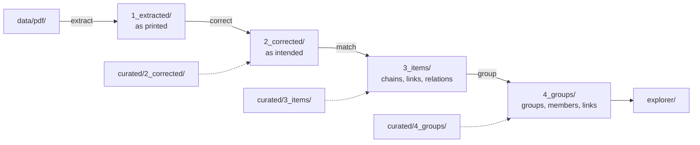

# Contributing

Requires Python 3.11+ and [uv](https://docs.astral.sh/uv/).

## The pipeline



`output/1_extracted/` reproduces each PDF exactly, typos included, so it
shows what changes when the extractor changes or a PDF is replaced. Every
deviation from the print is a row in `curated/`, applied to produce
`output/2_corrected/`, which has the same columns. `output/` is tracked so
that each change shows up as a diff, and the tests fail when a stage is out
of date; GitHub folds these files in diffs (`.gitattributes`).

```bash
uv run hiesir-codebook build                 # regenerate every stage of output/
uv run hiesir-codebook build --no-extract    # keep 1_extracted/ (no PDFs needed)
uv run hiesir-codebook all                   # just extract: PDFs -> output/1_extracted/
uv run hiesir-codebook 1382 1403             # or just some years
uv run python -m hiesir_codebook.correct --check   # correct and check against the raw data
uv run python -m hiesir_codebook.validate    # check extracted codes against the raw data
uv run python -m hiesir_codebook.explorer    # just the explorer page
```

## Fixing the data

Never edit `output/`. Every change goes into `curated/`, one row per decision,
each with its reason:

| File | What it fixes | Applied by |
|---|---|---|
| `2_corrected/corrections.csv` | single items and group headers in a single year: wrong codes, wrong texts, missing sections | `correct` |
| `2_corrected/spelling.csv` | spellings that recur across rows and years: typos, glued words, ZWNJs | `correct` |
| `2_corrected/spelling_suggestions.csv` | decisions on hazm's spelling suggestions (`find`): confirm, reject, change | `correct` |
| `3_items/links.csv` | decisions on 1 → 1 links between chains (`from_chain` → `to_chain`, same or recoded): confirm, reject, change, add | `relations` |
| `3_items/relations.csv` | decisions on merges, splits and regroupings between chain sets (`from_chains` → `to_chains`): confirm, reject, change, add | `relations` |
| `4_groups/links.csv` | decisions on links between group headers (`from_group` → `to_group`: continued, split, merged, regrouped, moved): confirm, reject, change, add | `groups` |

The columns of each are described in [Methods](methods.md): [corrections](methods.md#corrections)
and [matching decisions](methods.md#matching-items-across-years). After editing,
run `uv run hiesir-codebook build --no-extract` and review the diff in `output/`.

After changing the corrections or `spelling.csv`, regenerate the spelling
suggestions from hazm's dictionary (hazm needs Python 3.12 or 3.13), review the
`apply` `no` rows and overrule any suggestion in
`curated/2_corrected/spelling_suggestions.csv`:

```bash
uv run --python 3.13 --extra hazm python -m hiesir_codebook.spelling   # -> output/2_corrected/spelling_suggestions.csv
```

## Tests

```bash
uv run pytest                 # unit tests + regression against output/1_extracted/ (needs data/)
uv run pytest -m "not slow"   # unit tests only
uv run ruff check . && uv run ruff format --check .
```

The regression tests re-extract every year and compare byte-for-byte with
`output/1_extracted/`. When an extractor change is intended, regenerate with
`uv run hiesir-codebook all` and review the CSV diff before committing.
Fast tests also check that `output/2_corrected/`, `output/3_items/`,
`output/4_groups/` and `output/explorer/` are up to date; after changing `curated/` or the code, run
`uv run hiesir-codebook build --no-extract` and review the diff. Tests that
need `data/` (not in git) are skipped when it is missing, as on GitHub.

## Documentation

This site is built with [Material for MkDocs](https://squidfunk.github.io/mkdocs-material/)
from `docs/` and `mkdocs.yml`. The explorer and the CSVs are copied in from
`output/` at build time (`scripts/mkdocs_hooks.py`), so they are never duplicated in git.

The explorer is one component in `src/hiesir_codebook/data/explorer/`:
`explorer.js`, `explorer.css`, and `strings.js` with its English and Farsi
strings. The docs page `docs/explorer.md` (and `explorer.fa.md`) draws it
inside the site through `overrides/explorer.html`, taking the site's colours,
fonts and dark mode; the offline file `output/explorer/index.html` inlines the
same three files (`standalone.html`). Change the component once and both
follow.

Diagrams are written in [Mermaid](https://mermaid.js.org/) as a ` ```mermaid `
code block, so they stay text and take the site's light or dark theme. In the
Farsi page, use `flowchart RL` so that the flow reads right to left.

Every page has two versions: `page.md` (English) and `page.fa.md` (Farsi, served
under `/fa/`, right to left). A page without a Farsi version falls back to the
English one. When you change a page, update the other language too; Farsi
headings carry the English id (`## اصلاحات {#corrections}`) so that links work in
both languages.

```bash
uv run --group docs mkdocs serve      # preview at http://127.0.0.1:8000, reloads on save
uv run --group docs mkdocs build --strict   # what GitHub runs: fails on broken links
```

Every push to `main` runs the tests and publishes the site to GitHub Pages
(`.github/workflows/pages.yml`).

## Questionnaire PDFs

The PDFs are not in git: they are attached to the GitHub release
[`questionnaires`](https://github.com/Open-Data-for-Iran/HIESIR-Codebook/releases/tag/questionnaires),
and every site build downloads them and publishes them under `pdf/`, listed on
the [Questionnaires](questionnaires.md) page and linked from each item in the
explorer. To add or replace one, put it in `data/pdf/`, then

```bash
uv run python -m hiesir_codebook.pdfs stage   # data/pdf -> data/release, renamed questionnaire_<year>[_urban|_rural].pdf
```

and upload the file from `data/release/` to the release (Edit release, attach
files). Re-run the Docs workflow to publish it. A local build uses `data/release/`
or `data/pdf/` if present, or the folder in `$HIESIR_PDF_DIR`.

## License

MIT, see `LICENSE` in the repository.
