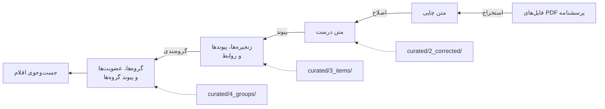

# راهنمای کدهای هزینه و درآمد خانوار

اقلام هزینه‌ای پرسشنامه‌های طرح آمارگیری هزینه و درآمد خانوار (HIES)،
سال‌های ۱۳۸۳ تا ۱۴۰۳: از فایل‌های PDF استخراج، اصلاح و در طول سال‌ها به هم
پیوند داده شده‌اند تا بتوان یک قلم را با وجود تغییر کد یا عبارتش دنبال کرد.

[باز کردن جست‌وجوی اقلام :material-magnify:](explorer.md){ .md-button .md-button--primary }
[دریافت داده‌ها :material-download:](data.md#quick-start){ .md-button }

## دنبال چه هستید؟

-   :material-magnify: **پیدا کردن یک قلم**

    ---

    یک کد (`011114`، یا شکل داده‌های خام `11114`) یا متن فارسی را جست‌وجو کنید
    و ببینید آن قلم در چه سال‌هایی پرسیده شده، کد و عبارتش چگونه تغییر کرده و
    آیا در طول سال‌ها قابل مقایسه است. یا یک بخش یا گروه و اقلام آن را مرور کنید.

    [جست‌وجوی اقلام](explorer.md)

-   :material-calendar-range: **تغییرات هر سال**

    ---

    اقلام جدید، حذف‌شده، تغییر کد داده، ادغام‌شده و تفکیک‌شده در هر پرسشنامه،
    همراه با بازطراحی‌های بزرگ سال‌های ۱۳۸۶، ۱۳۹۰ و ۱۳۹۵ در یک نگاه.

    [تغییرات به تفکیک سال](explorer.md#year=1386)

-   :material-table: **استفاده از داده‌ها**

    ---

    پرسشنامه‌های اصلاح‌شده و جدول‌های پیوند به صورت CSV، معنی ستون‌ها، و
    شیوه اتصال آن‌ها به داده‌های خام بدون از دست رفتن صفر ابتدای کدها.

    [فایل‌های داده](data.md)

-   :material-microscope: **بررسی روش کار**

    ---

    خطاهای چاپی پرسشنامه‌ها چگونه اصلاح شده‌اند، اقلام چگونه در طول سال‌ها به
    هم پیوند داده شده‌اند، و هر پیوند چگونه با تعداد خانوارها راستی‌آزمایی شده است.

    [روش کار](methods.md)

## در یک نگاه

| | |
|---|---|
| پرسشنامه‌ها | ۲۱ سال: ۱۳۸۲ تا ۱۴۰۰، ۱۴۰۲ و ۱۴۰۳ (فایل ۱۴۰۱ راهنمای داده است، نه پرسشنامه؛ ۱۳۶۳ تا ۱۳۸۱ فقط تصویر اسکن‌شده‌اند) |
| اقلام | حدود ۱٬۹۰۰ زنجیره: یک کد با یک عبارت، تا زمانی که هر دو ثابت بمانند |
| پیوندها | ۴۱۵ پیوند یک‌به‌یک که یک قلم را ادامه می‌دهد (عبارت تازه یا تغییر کد) و ۱۴۲ ادغام، تفکیک و بازگروه‌بندی؛ همه راستی‌آزمایی شده |
| اصلاحات | ۳۹ اصلاح در پرسشنامه‌های چاپی، به‌علاوه یکسان‌سازی املا و نشانه‌گذاری در همه سال‌ها |

## چگونه ساخته شده است

هر انحراف از متن چاپی، و هر تصمیمی که یک نفر درباره پیوند اقلام گرفته، یک
سطر در پوشه `curated/` همراه با دلیل آن است (ورودی‌های خط‌چین در نمودار)؛ بقیه
همه به‌طور خودکار ساخته می‌شود. برای ساختن دوباره یا پیشنهاد اصلاح، [مشارکت](contributing.md) را ببینید.
