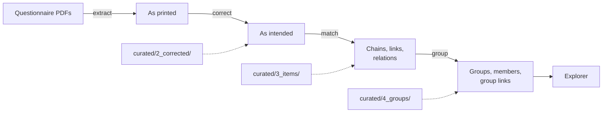

# HIESIR Codebook

The expenditure items of the Household Income and Expenditure Survey of Iran (HIES)
questionnaires, 1383–1403, extracted from the PDF forms, corrected, and
matched across years, so that the same item can be followed as its code and
wording change.

[Open the explorer :material-magnify:](explorer.md){ .md-button .md-button--primary }
[Download the data :material-download:](data.md#quick-start){ .md-button }

## What do you want to do?

-   :material-magnify: **Look up an item**

    ---

    Search a code (`011114`, or the raw data's `11114`) or Persian text and see
    the years it was asked, its code and label changes, and whether it is
    comparable across years. Or browse a section or group and its items.

    [Explorer](explorer.md)

-   :material-calendar-range: **See what a year changed**

    ---

    New, dropped, recoded, merged and split items for each questionnaire, with
    the big redesigns of 1386, 1390 and 1395 at a glance.

    [Changes by year](explorer.md#year=1386)

-   :material-table: **Use the data**

    ---

    The corrected questionnaires and the matched tables as CSV, the columns,
    and how to join them with the raw data without losing leading zeros.

    [Data files](data.md)

-   :material-microscope: **Check the method**

    ---

    How printing errors were corrected, how items are linked across years,
    and how each link was verified against household counts.

    [Methods](methods.md)

## At a glance

| | |
|---|---|
| Questionnaires | {{ questionnaires.years }} years: 1383–1400, 1402, 1403 (1382, with its older code scheme, is left out; 1401's PDF is a data dictionary; 1363–1381 are scans) |
| Items | {{ chains.total }} chains: one code with one label, followed while both stay the same |
| Links between them | {{ links.kept }} links that continue an item (reworded or recoded) and {{ relations.kept }} merges, splits and regroupings; every one verified |
| Corrections | {{ corrections.total }} fixes to the printed questionnaires, plus spelling and punctuation across all years |

## How it is made

Every deviation from the print, and every matching decision a person made, is
one row in `curated/` with its reason (the dashed inputs above); everything
else is generated. See [Contributing](contributing.md) to rebuild it or
propose a fix.
