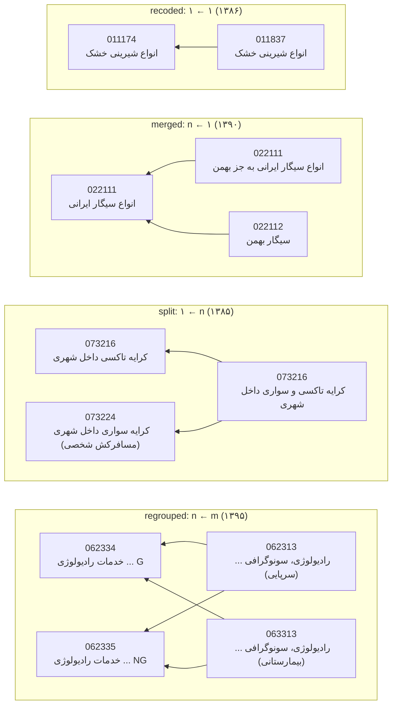
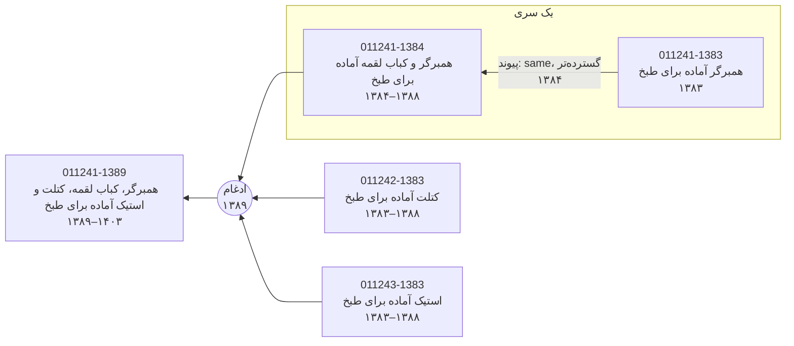
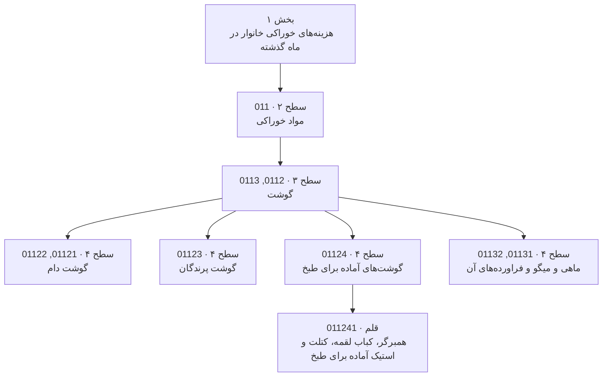
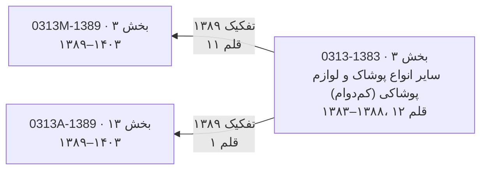

# روش کار

پرسشنامه‌ها چگونه اصلاح می‌شوند، اقلام چگونه در طول سال‌ها به هم پیوند داده می‌شوند، و راستی‌آزمایی به چه نتایجی رسید.
مراحل به ترتیبی اجرا می‌شوند که در [صفحه اصلی](index.md#how-it-is-made) آمده است.

## اصطلاحات {#terms}

| اصطلاح | معنی |
|---|---|
| **قلم** | یک سطر چاپی از یک پرسشنامه: یک کد هزینه و شرح آن، مثلاً `011241` همبرگر آماده برای طبخ در ۱۳۸۳ |
| **بخش** | یک بخش شماره‌دار پرسشنامه، مثلاً بخش ۱، خوراکی‌های خریداری‌شده در ماه گذشته؛ بخش ۱۳، خریدهای ۱۲ ماه گذشته |
| **گروه** | سرگروهی که بالای اقلام چاپ می‌شود (سطح ۲ تا ۴) و در طول سال‌ها دنبال می‌شود؛ شناسه‌اش کد و نخستین سال آن است، مثلاً `01124-1383` |
| **زنجیره** | یک کد با یک عبارت، تا زمانی که هر دو ثابت بمانند؛ شناسه‌اش کد و نخستین سال آن است، مثلاً `011241-1384` |
| **پیوند** | دو زنجیره را که همان قلم‌اند به هم وصل می‌کند (`same`: عبارت تازه؛ `recoded`: کد تازه)؛ همیشه یک زنجیره به یک زنجیره |
| **سری** | زنجیره‌هایی که با پیوند به هم وصل‌اند: یک قلم، تا زمانی که به‌تنهایی قابل مقایسه است |
| **رابطه** | ادغام، تفکیک یا بازگروه‌بندی: مجموعه‌ای از سری‌ها را پایان می‌دهد و مجموعه دیگری آغاز می‌کند |
| **پیوند گروه** | رابطه دو گروه، که از مسیر اقلامشان خوانده می‌شود (`continued`، `split`، `merged`، …) |
| **تصمیم** | چه کسی یک پیوند، رابطه یا پیوند گروه را قطعی کرده (`decided_by`): برنامه، یک سطر در `curated/`، یا هنوز هیچ‌کس (`open`) |

## اصلاحات {#corrections}

`curated/2_corrected/corrections.csv` خطاهای خودِ پرسشنامه‌ها را فهرست می‌کند، هر اصلاح در یک
سطر و همراه با شاهد آن:

| ستون | معنی |
|---|---|
| `year` | سال پرسشنامه |
| `action` | `recode` (تعیین کد هزینه قلم)، `retext` (تعیین شرح آن)، `delete` (حذف قلم، همراه با سرگروهی که خالی بماند)، `add_section` (کپی بخشی که در PDF نیست از سالی دیگر) یا `recode_header` / `retext_header` (تعیین کد یا شرح یک سرگروه؛ سطح آن از کد پیروی می‌کند) |
| `expenditure_code`، `description` | قلم به شکل چاپی (برای سرگروه: کد آن مانند `1_extracted`، مثلاً `062 M`)؛ وقتی یک کد دو بار چاپ شده، شرح دو سطر را از هم جدا می‌کند |
| `value` | کد یا متن اصلاح‌شده (برای `add_section`: سال مبدأ، و شماره بخش در `description`) |
| `reason` | شاهد: سال‌های مجاور، داده‌های خام |

{{ corrections.total }} اصلاح، همه در سال‌های {{ corrections.years }}، چند دسته‌اند:

- **غلط‌های کد:** اقلام اجاره احتسابی ۱۳۸۶ که زیر 0412 به جای 0421/0422 چاپ
  شده‌اند، و در همان سال 0144 به جای 0411، 0341 به جای 0431، 0736 به جای 0735؛
  کد 102216 به جای 103116 در ۱۳۸۴.
- **شرح در سطر اشتباه:** دو شرح در ۱۳۸۶ که از سطر بالا کپی شده‌اند، و شرح‌هایی
  که پایانشان در سطر بعد چاپ شده است (093124/093125 در ۱۳۸۶ تا ۱۳۸۹،
  123215/123216 در ۱۳۸۶).
- **برچسب جدول که جزو شرح خوانده شده:** برچسب ستون یا خانه‌ای مانند
  `مبلغ رهن (ریال)` (042212، ۱۳۸۳ تا ۱۳۸۵)، و دو مورد دیگر در ۱۳۸۶ و ۱۳۸۷.
- **پایان بریده‌شده:** سه شرح بخش ۱۴ (34170، 34250، 34261) در ۱۳۸۳ و ۱۳۸۴.
- **بخش جاافتاده:** بخش ۲ (دخانیات) که صفحه‌اش در PDF سال ۱۳۸۳ خالی است، از
  ۱۳۸۴ کپی شده، بدون 023111 که هیچ خانواری در ۱۳۸۳ گزارشش نکرده است.
- **سرگروه‌ها:** `062 M` که به جای `0562 M` چاپ شده (۱۳۸۶)، سرگروه دندان‌پزشکی
  0622 که با عنوان 0621 چاپ شده (۱۳۸۶)، و `124 M` که به صورت `1241 M` چاپ شده
  (۱۳۸۸ تا ۱۳۹۰).

پس از اصلاحات فهرست‌شده، نشانه‌گذاری همه شرح‌ها یکدست می‌شود
(`correction/rules.py`: `tidy_punctuation`)، روی هم {{ labels.punctuation }} شرح:

- «،»، «؛»، «:»، «؟» و «!» به واژه پیش از خود می‌چسبند و پس از آن‌ها یک فاصله
  می‌آید: `آرد ، رشته ،غلات` ← `آرد، رشته، غلات`؛
- ویرگول لاتین میان واژه‌ها به «،» تبدیل می‌شود (`1,000` تغییر نمی‌کند)؛
- نشانه تکراری یک بار نوشته می‌شود: `دیس،،` ← `دیس،`؛
- حرف ربط «و» پس از نیم‌فاصله واژه‌ای جدا می‌شود: `وسایل‌و لوازم` ← `وسایل و لوازم`؛
- پیش از پرانتز باز یک فاصله و پس از آن هیچ؛ پیش از پرانتز بسته هیچ و پس از آن
  یک فاصله: `نان ماشینی( لواش )سنگک` ← `نان ماشینی (لواش) سنگک`؛
- دو نقطه یا بیشتر، با فاصله یا بی‌فاصله، به `...` تبدیل می‌شود با یک فاصله پیش
  از آن (مگر پس از پرانتز باز) و پیش از واژه بعدی:
  `و. . .` ← `و ...`، `و...وسایر` ← `و ... وسایر`؛
- نقطه تنها در عبارت‌ها هرگز نقطه پایان جمله نیست: پس از `و` سه‌نقطه‌ای است که
  کوتاه چاپ شده (`ختنه اطفال و.)` ← `ختنه اطفال و ...)`)، میان دو واژه‌ای که به هم
  می‌چسباند جداکننده است (`نوارقلب.نوارمغز` ← `نوارقلب، نوارمغز`) و جای دیگر حذف
  می‌شود (`کاکائو. و` ← `کاکائو و`، `نشده است.` ← `نشده است`)؛ نقطه کنار رقم یا
  حرف لاتین می‌ماند؛
- میان واژه فارسی و عدد فاصله می‌آید: `در12ماه` ← `در 12 ماه`،
  `پژو405` ← `پژو 405` (`MP3` لاتین تغییر نمی‌کند)؛
- خط مورب میان واژه‌ها از دو طرف فاصله می‌گیرد: `دبیرستان/ متوسطه` ←
  `دبیرستان / متوسطه` (`1/2` تغییر نمی‌کند).

همین گام قاعده‌های املایی فرهنگستان زبان و ادب فارسی را که به فهرست واژه نیاز
ندارند اعمال می‌کند (`rules.standard_spelling`):

- پسوند «ی» پس از مصوت «یی» نوشته می‌شود، نه «ئی»: `دمپائی` ← `دمپایی`،
  `روستائیان` ← `روستاییان`، `هوائی` ← `هوایی`؛ فقط در پایان واژه یا پیش از
  «ان» / «ها»، پس واژه‌های قرضی شکل خود را نگه می‌دارند (`گازوئیل`، `موزائیک`).

یک قاعده جای فهرستی از واژه‌ها را می‌گیرد: این یکی ۱۵ سطر `spelling.csv` را
بی‌نیاز کرد.

سپس `curated/2_corrected/spelling.csv` املاهایی را که در سطرها و سال‌های مختلف تکرار
می‌شوند اصلاح می‌کند و به ترتیب فایل روی همه شرح‌ها اعمال می‌شود:

| ستون | معنی |
|---|---|
| `find` | شکل نادرست (می‌تواند چند واژه باشد)، همان‌طور که پس از قواعد نشانه‌گذاری خوانده می‌شود؛ نیم‌فاصله‌ها نادیده گرفته می‌شوند، پس `شدهباشد` به `شده‌باشد` هم می‌خورد |
| `replace` | شکل درست |
| `match` | `word`: فقط واژه کامل (`بجز` روی `بجزروانی` اثر ندارد)؛ `text`: هر جای عبارت |
| `years` | خالی برای همه سال‌ها، یا سال‌ها و بازه‌ها: `1386`، `1383-1385 1390` |
| `reason` | دلیل |

این فایل پس از اصلاح خودکار با hazm (پایین) اعمال می‌شود، پس فقط آنچه را hazm
نمی‌تواند حل کند در بر دارد. {{ spelling.total }} سطر آن {{ labels.spelling }} شرح را
تغییر می‌دهند. سطرهای آن این‌ها را در بر می‌گیرند:

- غلط‌های تایپی (`دیبرستان` ← `دبیرستان`، `رایو` ← `رادیو`، `کارت کدملی` ← `کارت ملی`)،
  یک املا برای هر واژه (`بجز` ← `به جز`، `جابجایی` ← `جابه‌جایی`، `پینگ‌پنگ`،
  و «ی» به جای «ئ» هر جا هر دو رایج است: `ویدیو`، `آینه`، `تزیینی`)؛
- «و» چسبیده به واژه بعد (`وپلاستیکی` ← `و پلاستیکی`)، واژه‌های به هم چسبیده یا
  پیوسته با نیم‌فاصله نابجا (`لباسزیر` ← `لباس زیر`،
  `پزشک‌متخصص` ← `پزشک متخصص`)، مطابق شیوه‌ای که خودِ پرسشنامه‌ها معمولاً آن
  جفت را می‌نویسند؛
- نیم‌فاصله‌هایی که املای معیار لازم می‌داند: جمع `ها`/`های`، `ه` + `ای`، `می`؛
- ترکیب‌هایی که پرسشنامه‌ها پیوسته می‌نویسند با نیم‌فاصله نوشته می‌شوند
  (`ثبت‌نام`، `سیب‌زمینی`، `پاک‌کن`)؛ ترکیب‌هایی که همیشه جدا نوشته شده‌اند جدا
  می‌مانند (`سی دی`، `پرداخت شده`). `--check` نشان می‌دهد هر سطر چند شرح را تغییر
  داده، و اجرای برنامه درباره سطرهایی که با هیچ متنی جور نمی‌شوند هشدار می‌دهد.

**اصلاح خودکار با hazm.** پیش از `spelling.csv`، `output/2_corrected/autocorrect/hazm.csv`
اصلاح‌هایی را اعمال می‌کند که به‌طور خودکار با فهرست واژه‌های
[hazm](https://github.com/roshan-research/hazm) پیدا شده‌اند. `autocorrect.py` هر
عبارت را یک بار، مستقیم از فایل استخراج‌شده و فقط با اصلاحات و سبک یکسان، می‌خواند
تا خطاهای خود چاپ را ببیند، قاعده‌هایش
را روی هر واژه می‌آزماید و یافته‌ها را، هر واژه در یک سطر، ذخیره می‌کند (`find`،
`replace`، `rule`، `uses`، `years`، `evidence`، `example`)؛ برنامه این فایل را به‌صورت
اصلاح واژه کامل اعمال می‌کند، پس به داده hazm نیازی ندارد. فهرست hazm واژه‌هایی که
در پیکره‌اش دیده شده‌اند، واژه‌هایی با نقش دستوری ولی بی بسامد، و حدود ۱۵۸ هزار
مدخل خالی را با هم دارد که بیشترشان واژه‌های نادرند ولی واژه‌های چسبیده نادرست
(`ویخ`، `وکم`) هم در آن‌ها هست؛ واژه‌ای *شناخته* است که hazm آن را تأیید کند (بسامد یا
نقش دستوری داشته باشد)، *شناخته با پسوند* است اگر چنین واژه‌ای با پسوندی باشد که hazm
آن را با آن پسوند ندارد (جمع ها / های، ی، ای، یی، ان، ات، تر، ترین: `کالاهای` = `کالا` + های)،
و *فهرست‌شده* است اگر اصلاً در فهرست باشد.
`curated/2_corrected/words.csv` (`word`، `reason`) واژه‌های درستی را که hazm ندارد
می‌افزاید. قاعده‌ها:

| `rule` | چه چیزی را اصلاح می‌کند | نمونه |
|---|---|---|
| `glued_vav` | واژه‌ای که با `و` آغاز می‌شود و بدون آن رتبه بالاتری دارد (شناخته > واژه شناخته با پسوند > فهرست‌شده > نبودن در فهرست؛ در تساوی واژه می‌ماند): حرف ربط چسبیده به واژه بعد | `ویخ` ← `و یخ`، `وسنگی` ← `و سنگی`، `وپلاستیکی` ← `و پلاستیکی` (پلاستیک + ی)؛ `ورنی`، `ویفر` و `ورودی` (ورود + ی در برابر رود + ی) می‌مانند |
| `glued_words` | واژه‌هایی که پیوسته یا با نیم‌فاصله نابجا نوشته شده‌اند، به واژه‌ها بریده می‌شوند: فقط واژه‌ای که در فهرست hazm نیست؛ هر پاره رایج یا در عبارت‌ها پرکاربرد؛ بر پایه رایج بودن و کم بودن پاره‌ها امتیاز می‌گیرد و بریدنی که عبارت‌ها جای دیگری نوشته‌اند امتیاز بیشتری دارد و فقط اگر آشکارا از بعدی جلوتر باشد پذیرفته می‌شود؛ چسبیدگی‌ای که هر سال چاپ شده فقط کنار یک واژه پیونددهنده (و، در، سایر …) بریده می‌شود؛ بن مضارع فعل (کش، دار، بند، کن …) به واژه پیش از خود چسبیده می‌ماند تا واژه‌های مرکب درست بمانند | `پودرپیاز` ← `پودر پیاز`، `ونظایرآن` ← `و نظایر آن`؛ `اطوکشی`، `ترکبند`، `عزاداری` می‌مانند |
| `joined_plural` | واژه شناخته‌ای که نشانه جمع (ها، های، هایی) بی نیم‌فاصله به آن چسبیده، روی عبارت‌ها پس از `glued_vav`؛ پس از `ا د ذ ر ز ژ و`، وقتی hazm خود همین نوشته را تأیید کند، و وقتی ممکن است `و` چسبیده هم باشد می‌ماند | `سالنهای` ← `سالن‌های`، `آنها` ← `آن‌ها`؛ `کالاها`، `تنها`، `وبهای` می‌مانند |
| `compound` | دو واژه‌ای که hazm آن‌ها را یک واژه مرکب با نیم‌فاصله می‌داند، حتی اگر پرسشنامه‌ها همیشه جدا چاپ کرده باشند؛ هرگز با واژه دستوری، گروه فعلی (`پرداخت شده`) یا سرواژه‌ای که سبک یکسان جدا می‌نویسد (`قابل`، `غیر`) | `تخم مرغ` ← `تخم‌مرغ`، `لوله کشی` ← `لوله‌کشی`، `نمک سود` ← `نمک‌سود`، `زرشک پلو` ← `زرشک‌پلو` |
| `spaced_suffix` | واژه شناخته و پسوندی که جدا نوشته شده (ها، های، هایی، ترین، و ای پس از ه)، روی عبارت‌ها پس از `glued_vav`: با نیم‌فاصله پیوسته می‌شود، یا پس از `ا د ذ ر ز ژ و` بی هیچ فاصله‌ای؛ اگر هر دو با هم خود واژه‌ای باشند می‌ماند | `نمایش های` ← `نمایش‌های`، `پارچه ای` ← `پارچه‌ای`، `پودر های` ← `پودرهای`؛ `تن ها` می‌ماند (`تنها`) |

جایی که سطر واژه‌ای از `spelling.csv` با عبارتی جور می‌شود، اصلاح خودکار آن تکه از
عبارت را به آن سطر وامی‌گذارد، هم هنگام یافتن و هم هنگام اعمال، تا تصمیم دستی همیشه
برنده باشد (فقط `spaced_suffix` که واژه‌ای را تغییر نمی‌دهد از آن می‌گذرد). اصلاح‌های
حرفی `spelling.csv` (سطرهای `text`: `تزئین` ← `تزیین`، `هزنیه` ← `هزینه`) پیش از اصلاح
خودکار و همراه سبک یکسان اعمال می‌شوند. فهرست hazm با یکی کردن شکل‌های همزه (`تامین`
همان `تأمین` است)، با صورت‌های فعل‌هایش (`verbs.dat`: `شده`، `می‌شود`، `کننده`) و با
`curated/2_corrected/words.csv` خوانده می‌شود.

این فایل {{ autocorrect.total }} اصلاح دارد که {{ labels.autocorrect }} شرح را تغییر
می‌دهند. پس از تغییر اصلاحات، سبک یکسان یا قاعده‌ها، با داده hazm دانلودشده
(`uv run hiesir-codebook hazm download`) آن را دوباره بسازید؛ آزمونی، هر جا داده
باشد، به‌روز بودن آن را بررسی می‌کند:

```bash
uv run python -m hiesir_codebook.correction.autocorrect
```

`--check` هر دو را با جدول تعداد خانوارهای گزارش‌دهنده هر کد می‌آزماید:

- هر اصلاح: کد جدید قلمی که کدش تغییر کرده باید در آن سال از سوی خانوارها گزارش
  شده باشد، کد قلم حذف‌شده نباید گزارش شده باشد، و هر قلمی که به سالی کپی شده باید
  در آن سال گزارش شده باشد؛
- هر پرسشنامه اصلاح‌شده: کدی که خانوارها گزارش کرده‌اند ولی در پرسشنامه نیست، یا
  کدی که دو بار چاپ شده، نشانه غلط تایپی یا جاافتادگی در استخراج است.

همه اصلاحات با داده پشتیبانی می‌شوند و همه سال‌های ۱۳۸۳ تا ۱۴۰۳ از این آزمون
عبور می‌کنند. جدول‌های تعداد خانوار در git هستند، پس یک آزمون این بررسی را در CI
اجرا می‌کند.

بررسی ساختار (`python -m hiesir_codebook.correction.corrections`) به داده نیازی
ندارد: فقط از روی CSVها کد دو بار چاپ‌شده، زیرکد یا بخش بی‌ترتیب، سرگروه یا قلم
بی‌شرح، کد نادرست و قلمی را که کد سرگروهش آن را نمی‌پوشاند پیدا می‌کند.
پرسشنامه‌های اصلاح‌شده هیچ‌کدام را ندارند. برخی سرگروه‌ها همین‌طور چاپ شده‌اند: زیر
`06312` (بیمارستان‌های تخصصی) اقلام به صورت `0631 21` تا `0631 36` بی‌سرگروه
جداگانه ادامه می‌یابند. `curated/2_corrected/header_exceptions.csv` این‌ها را
می‌پذیرد (سرگروه، کد قلم، سال‌ها، دلیل: آنچه PDF نشان می‌دهد)؛ سطری که دیگر چیزی را
نمی‌پذیرد کهنه گزارش می‌شود. در `output/1_extracted/` این بررسی دقیقاً همان
غلط‌های چاپی را می‌یابد که `corrections.csv` اصلاح می‌کند (۱۳۸۶: 041211 تا 041213
و 073611 دو بار چاپ‌شده، سرگروه 062 M؛ ۱۳۸۴: 102216).

## پیوند اقلام در طول سال‌ها {#matching-items-across-years}

`output/3_items/` هر قلم را در پرسشنامه‌های ۱۳۸۳ تا ۱۴۰۳ به صورت یک *سری*
دنبال می‌کند: همان چیزی که سال به سال پرسیده می‌شود، حتی اگر عبارتش کمی تغییر
کند، کدش عوض شود یا در سالی پرسیده نشود.

```bash
uv run python -m hiesir_codebook.linking.chains      # stage 1: output/2_corrected/ -> output/3_items/chains.csv
uv run python -m hiesir_codebook.linking.relations   # stage 2: chains.csv -> output/3_items/links.csv, relations.csv
```

تطبیق در دو مرحله انجام می‌شود.

**مرحله ۱، زنجیره‌ها.** *زنجیره* یک کد هزینه با یک عبارت است که سال به سال
دنبال می‌شود تا زمانی که هر دو ثابت بمانند (عبارت‌هایی که فقط در فاصله،
نیم‌فاصله، نشانه‌گذاری، همزه یا شکل رقم فرق دارند یکسان حساب می‌شوند). هر تغییر
دیگری در عبارت، یا ناپدید شدن کد در بیش از دو پرسشنامه، زنجیره تازه‌ای آغاز
می‌کند. پس هر زنجیره یک کد و یک متن دارد و هر قلمِ هر سال دقیقاً به یک زنجیره
تعلق دارد. `chains.csv` برای هر زنجیره یک سطر دارد: `chain_id` (کد و نخستین سال،
مثلاً `011114-1387`)، `section`، `expenditure_code`، `first_year`، `last_year`،
`missing_years`، `text`.

**مرحله ۲، پیوندها و رابطه‌ها.** هر پیوند یک *مجموعه* از زنجیره‌های پیشین را به یک
*مجموعه* از زنجیره‌های پسین وصل می‌کند؛ شکل پیوند نوع آن را تعیین می‌کند:

| `relation` | شکل | نمونه |
|---|---|---|
| `same` | ۱ ← ۱، همان کد | برنج چمپا و آشی ← برنج آشی |
| `recoded` | ۱ ← ۱، کد جدید | شیرینی خشک: 011837 ← 011174 (۱۳۸۶) |
| `merged` | n ← ۱ | باغبانی + سرایداری + میراب ← یک قلم (۱۳۸۶)؛ تلویزیون ۲۱ اینچ + سایر تلویزیون‌ها ← همه تلویزیون‌ها (۱۳۹۰) |
| `split` | ۱ ← n | خدمات آمبولانس ← G / NG (۱۳۹۵) |
| `regrouped` | n ← m | دستی افزوده شده، مثلاً اقلام دندان‌پزشکی ۱۳۹۵ |

یک نمونه از هر شکل (کدها و عبارت‌ها همان‌طور که چاپ شده‌اند):



این دو خانواده کار متفاوتی می‌کنند، پس در فایل‌های جدا نگه داشته می‌شوند:

- **پیوندهای یک‌به‌یک** (links: `same`، `recoded`؛ همیشه ۱ ← ۱) یک قلم را *ادامه*
  می‌دهند. زنجیره‌هایی که یک پیوند به هم وصل می‌کند یک سری‌اند، و پرسش
  راستی‌آزمایی این است که دامنه عبارت چگونه تغییر کرده. `links.csv` این ستون‌ها
  را دارد: `link_id` (`L0001`…)، `from_chain`، `to_chain`، `relation`، `detail`
  (`minor`، `label_broadened`، `label_narrowed`، `label_reworded`، یا خالی وقتی
  عبارت یکسان است)، `year` (سال تغییر)، `score`، `decided_by`،
  `verified`، `note`، و متن دو طرف برای خواندن.
- **رابطه‌ها** (relations: `merged`، `split`، `regrouped`) سری‌ها را *پایان*
  می‌دهند و سری‌های دیگری آغاز می‌کنند. پرسش این است که کدام زنجیره‌ها در هر طرف
  جای دارند. `relations.csv` همان ستون‌ها را دارد، با `relation_id` (`R0001`…) و
  `from_chains` / `to_chains` (شناسه زنجیره‌ها با فاصله از هم جدا). زنجیره‌ای که با
  عبارت بدون تغییر ادامه می‌یابد می‌تواند در هر دو طرف یک ادغام یا تفکیک بیاید.

همبرگر آماده برای طبخ هر دو را نشان می‌دهد. عبارت نخستش فقط در ۱۳۸۳ چاپ شده؛
در ۱۳۸۴ «کباب لقمه» به آن افزوده می‌شود، پیوندی (`same`، گسترده‌تر) که سری را یکی
نگه می‌دارد. در ۱۳۸۹ اقلام کتلت و استیک پایان می‌یابند و عبارت همبرگر آن‌ها را در
بر می‌گیرد: یک ادغام (`R0003`) سه سری را پایان می‌دهد و یکی را آغاز می‌کند. از
۱۳۸۹ همبرگر به‌تنهایی در ۱۳۸۸ همتایی ندارد؛ جمع هر سه دارد.



هر دو در یک گذر یافته می‌شوند، چون ادغام با گسترش یک پیوند یک‌به‌یک پیدا می‌شود.
این دو باید با هم سازگار باشند: هر زنجیره دست‌بالا یک پیوند رو به جلو و یک پیوند رو
به عقب دارد، و زنجیره‌ای که یک ادغام، تفکیک یا بازگروه‌بندی پایانش می‌دهد (یا
آغازش می‌کند) پیوند یک‌به‌یکی رو به جلو (یا رو به عقب) ندارد، مگر آن‌که در هر دو
طرف آمده باشد. ساخت هر ناسازگاری را گزارش می‌کند و یک آزمون روی آن شکست می‌خورد.

برنامه این پیوندها را پیدا می‌کند: پیوندهای ۱ ← ۱ درون یک کد؛ تغییر کدها (زنجیره‌ای
که پایان می‌یابد و زنجیره مشابهی که سال بعد با کد جدید آغاز می‌شود)؛ ادغام‌ها
(زنجیره پایان‌یافته‌ای که عبارتش در زنجیره دیگری ادامه دارد؛ قلم «سایر X» که به
«X» تبدیل می‌شود در حالی که بقیه گروهش ناپدید می‌شوند)؛ و تفکیک‌ها (زنجیره
تازه‌ای که عبارتش بخشی از زنجیره‌ای قدیمی‌تر بوده؛ قلمی که برای همه ارائه‌دهندگان
پرسیده می‌شد و به جفت G / NG تبدیل می‌شود).

وقتی عبارت تازه یک کد بی‌ربط است، آن کد برای قلم دیگری به کار رفته است. این پیوند
نیست و چیزی در `links.csv` نمی‌آید؛ {{ code_reuse }} جفت (مثلاً 053125: انواع آبگرمکن گازی
← کولرگازی) برای بازبینی در `reports/code_reuse.csv` فهرست شده‌اند.

**چه کسی تصمیم می‌گیرد.** هر پیوند، رابطه و پیوند گروهی ستون `decided_by` دارد:

| `decided_by` | معنی |
|---|---|
| `code` | برنامه آن را پیدا می‌کند و مطمئن است: سطری در `curated/` ندارد |
| `curated` | سطری در `curated/` درباره‌اش تصمیم گرفته؛ `verified` می‌گوید چه تصمیمی (`confirmed`، `changed`، `added`، `rejected`) |
| `open` | برنامه آن را پیدا کرده ولی مطمئن نیست، و هنوز کسی تصمیم نگرفته |

یک پیوند ۱ ← ۱ *قطعی* است (`decided_by` برابر `code`)
وقتی هر دو عبارت واژه‌های محتوایی یکسانی دارند، یعنی فقط نشانه‌گذاری، حرف ربط
(`،` / `و`)، ترتیب واژه‌ها، فاصله، واژه‌های عام (`انواع`) یا نشانه‌های «و غیره»
(`و نظایر آن` / `و ...`) فرق دارند: `جگر، دل، قلوه` ← `جگر، دل و قلوه`. هر پیوند
دیگر، و هر ادغام، تفکیک یا بازگروه‌بندی، نیاز به بررسی دارد. اکنون تکلیف همه روشن
است: از {{ links.total }} پیوند یک‌به‌یک، {{ links.code }} قطعی‌اند و `curated/3_items/links.csv` درباره بقیه تصمیم
می‌گیرد ({{ links.confirmed }} تأیید، {{ links.changed }} تغییر، {{ links.rejected }} رد، {{ links.added }} افزوده)؛ `curated/3_items/relations.csv` درباره هر
{{ relations.total }} ادغام، تفکیک و بازگروه‌بندی تصمیم می‌گیرد ({{ relations.confirmed }} تأیید، {{ relations.rejected }} رد، {{ relations.added }} افزوده).

تصمیم‌ها در `curated/3_items/links.csv` و `curated/3_items/relations.csv` ثبت می‌شوند، هر پیوند در
یک سطر و با نام زنجیره‌هایش:

| ستون | معنی |
|---|---|
| `from_chain`، `to_chain` (links.csv) | هر کدام یک شناسه زنجیره |
| `from_chains`، `to_chains` (relations.csv) | زنجیره‌های هر طرف، شناسه‌ها با فاصله از هم جدا |
| `decision` | `confirm` (همان‌طور که یافت شده درست است)، `reject` (این‌گونه مرتبط نیستند)، `change` (زنجیره‌ها درست‌اند، `relation`/`detail` دیگری به کار رود) یا `add` (پیوندی که برنامه نیافته، مثلاً بازگروه‌بندی) |
| `relation`، `detail` | برای `change` و `add` |
| `note` | دلیل |

تصمیم‌های ۱ ← ۱ با جدول تعداد خانوارهای گزارش‌دهنده هر کد
(`data/commodity_code_occurrence_1383-1403.csv`) بررسی شدند. یادداشت، تعداد
خانوارهایی را که کد قدیم را در سال پیش از تغییر و کد جدید را در سال تغییر گزارش
کرده‌اند، به صورت نسبتی در مقایسه با سایر کدهای همان گروه می‌دهد، تا نوسان‌های
کل طرح، مانند ۱۳۸۷ یا سال کرونایی ۱۳۹۹، خنثی شوند. همچنین می‌گوید این نسبت با
تغییر دامنه جور است یا نه: عبارتی که گسترده‌تر شده نباید خانوارهای زیادی از دست
بدهد و عبارتی که محدودتر شده نباید خانوارهای زیادی به دست آورد. تعداد کمتر از
۱۰۰ برای داوری کافی نیست. هر جا خوانش عبارت نادرست بوده، سطر از نوع `change`
است. حذف یک قید یا استثنا (`در منزل`، `ساخت داخل`، `به جز بهمن`) قلم را گسترده‌تر
می‌کند و افزودن آن (`ذرت` ← `ذرت شیرین`) محدودتر. مقایسه، واژه‌ها را می‌شمارد،
پس این موارد را برعکس می‌خواند.

`relations` این شاهد را در هر بار ساخت برای همه پیوندها حساب می‌کند و در
`reports/relation_evidence.csv` می‌نویسد، با ستون‌های `before_year`، `before`،
`after`، `group`، `ratio` و `verdict` (`fits`، `does not fit`، `too few`،
`no data`). همچنین داوری پیوندهایی را که هنوز باید بررسی شوند چاپ می‌کند. یک
آزمون بررسی می‌کند که شاهد نقل‌شده در یادداشت‌های تصمیم‌ها هنوز همان چیزی باشد
که برنامه حساب می‌کند.

ادغام‌ها و تفکیک‌ها معیار دیگری لازم دارند، چون جدول، خانوارها را می‌شمارد نه
خریدها را: خانواری که دو کد را گزارش کرده که بعداً ادغام شده‌اند، پس از ادغام یک
بار شمرده می‌شود. پس پس از ادغام، تعداد میان بزرگ‌ترین مبدأ و مجموع مبدأها
است. پیش از تفکیک، مبدأ میان بزرگ‌ترین مقصد و مجموع مقصدها است. شاهد این بازه
را می‌دهد (`expected x0.32-1.67`). یک کد هم‌گروه فقط وقتی وارد مقایسه گروه
می‌شود که یک زنجیره آن را در هر دو سال بپرسد، تا کدی که برای قلم دیگری به کار
رفته مقایسه را مخدوش نکند.

یافته‌های راستی‌آزمایی:

- **جهت نادرست.** حذف یک قید قلم را گسترده‌تر و افزودن آن محدودتر می‌کند، و
  مقایسه هر دو را برعکس می‌خواند (۲۲ مورد از {{ links.changed }} پیوند تغییریافته، بالا را ببینید).
- **اقلام «خارج از منزل» (۱۳۸۶).** 062315، 062321، 062323، 062328 و 062331 وقتی
  پایان یافتند که همتاهای «در منزل»شان قید `در منزل` را از دست دادند. این‌ها
  ادغام‌اند نه گسترش: واکسیناسیون در منزل (۲۳۳ خانوار) به‌علاوه خارج از منزل
  (۳٬۵۲۰) یک قلم شد (۳٬۹۰۹).
- **خدمات بیمارستانی (۱۳۸۶).** هفت قلم هزینه هر نوع بیمارستان (اداری، تخت،
  خوراک، اورژانس، آمبولانس، دارو، تجهیزات، 063411 تا 063447) یک قلم شدند
  (063418/28/38/48). برنامه اقلام دارو را به داروهای بیماری‌های خاص و اقلام اداری
  را به آزمایش ادرار فرستاده بود.
- **بازطراحی بخش سلامت در ۱۳۹۵.** خدمات سرپایی و بستری بازگروه‌بندی و بر حسب
  ارائه‌دهنده (G/NG) تفکیک شدند: ویزیت، دندان‌پزشکی، رادیولوژی، آزمایش، خدمات
  پیراپزشکی، دیالیز و شیمی‌درمانی، وسایل پزشکی و صورت‌حساب‌های بستری. ویزیت در
  بیمارستان‌ها (0631، 0633) به اقلام سرپایی پیوست. این‌ها بازگروه‌بندی‌های
  افزوده (`add`) هستند. داروها به با نسخه و بدون نسخه، و ترک اعتیاد بر حسب محل،
  تفکیک شدند.
- **اقلام تازه‌ای که تفکیک پنداشته شده بودند.** وقتی قلم قدیمی خانوارهایش را حفظ
  کرده و قلم تازه از آن جدا نشده، تفکیک رد می‌شود: خمیر نان (011166) از مخمرِ
  011934 جدا نشده؛ لباس ورزشی کودکان (031262) و سایر کالاهای بی‌دوام (056154)
  تازه‌اند.
- **جاافتاده از ادغام‌ها.** جراحی لوزه و آپاندیس (۱۳۸۶)، تعمیر سمعک (۱۳۸۶) و
  گوشت شکار 011219 که به 011221 رفت (واژه `شکار` را افزود)، نه به پرندگان شکاری.
- **گسترش‌هایی که ادغام بودند.** قلمی که درست هم‌زمان با کنار رفتن قلم دیگری
  یک استثنا یا قید را حذف می‌کند، یا واژه‌هایی می‌افزاید که همان قلم را نام
  می‌برند، آن قلم را در خود گرفته است: «انواع سیگار ایرانی به جز بهمن» و «سیگار
  بهمن» در ۱۳۹۰ «انواع سیگار ایرانی» شدند، و در ۱۳۸۶ مسواک، خمیردندان و کرم
  ساخت خارج به اقلام داخلی پیوستند، فیلم‌برداری به عکاسی، و نوار و لوح ضبط‌شده به
  نوع خام، و در ۱۳۹۲ جراحی سرپایی «کاشت مو» را افزود، هم‌زمان با کنار رفتن قلم
  کاشت مو در بخش ۱۲. ۲۱ پیوندِ گسترش در واقع چنین ادغام‌هایی بودند (۱۸ ادغام و
  دو بازگروه‌بندی سه قلم به دو قلم: دوچرخه‌های ۱۳۹۰، و در ۱۳۸۴ دوچرخه و سه‌چرخه
  تفریحی و روروئک (093115) که سه‌چرخه‌اش به دوچرخه نمره ۱۶ و روروئکش به
  ملزومات نوزاد در بخش ۱۲ رفت). تعداد خانوارها در همه
  موارد سازگار است و دو مورد را قطعی می‌کند: اگر گسترش بودند، لوح‌های ضبط‌شده و
  دوچرخه نمره ۲۸ سه برابر می‌شدند. دو پیوندِ محدودتر شده هم به همین شکل تفکیک
  بودند: «کرایه تاکسی و سواری داخل شهری» واژه «سواری» را کنار گذاشت، هم‌زمان با
  آغاز «کرایه سواری داخل شهری (مسافرکش شخصی)» (۱۳۸۵)، و قلم پتوی برقی تب‌سنج و
  کیسه آبجوش را کنار گذاشت، هم‌زمان با آغاز «تب‌سنج، کیسه آبجوش، کیسه یخ»
  (۱۳۸۹). جست‌وجوی همه پیوندهای گسترده‌تر یا محدودتر شده برای قلمی که کنارشان،
  با واژه‌هایی که عنوان افزوده یا کنار گذاشته، پایان یافته یا آغاز شده، مورد
  دیگری در همان گروه نمی‌یابد؛ بازگروه‌بندی ۱۳۸۴ از گروه و بخش می‌گذرد و با خواندن
  عنوان‌ها پیدا شد.

هر جا تعدادها هنوز جور نیستند، یادداشت دلیلش را می‌گوید، مثلاً: کاهش تلفن ثابت
با گسترش تلفن همراه؛ بسته شدن کافی‌نت‌ها در کرونای ۱۳۹۹؛ جابه‌جایی گزارش‌ها میان
کدهای بیمه؛ جهشی در کل طرح با عبارت بدون تغییر (125112 در ۱۳۸۴، 127119 در
۱۳۸۷). سه یادداشت علت را باز می‌گذارند: نصف شدن 053312 در ۱۳۹۰، نصف شدن
هزینه جراحی دولتی در ۱۳۸۶، و افزایش دیالیز و شیمی‌درمانی از ۳۶ به ۲۰۷ خانوار در
۱۳۹۵.

هر فایل فقط نوع خودش را می‌پذیرد: `change` یا `add` با `merged` در
`curated/3_items/links.csv`، یا با `same` در `curated/3_items/relations.csv`، خطاست. برای تغییر
زنجیره‌های یک پیوند، آن را رد کنید و پیوند درست را بیفزایید؛ وقتی یک ادغام جای یک
پیوند یک‌به‌یک را می‌گیرد (اقلام «خارج از منزل»)، آن پیوند را رد کنید.
`links.csv` و `relations.csv` هر تصمیم را در `verified` (`confirmed`، `rejected`، `changed`،
`added`) و `note` ثبت می‌کند؛ پیوندهای ردشده در فایل می‌مانند ولی مراحل بعد
نادیده‌شان می‌گیرند. تصمیمی که پیوندش پیدا نشود (مثلاً پس از آن‌که اصلاح یک
عبارت دو زنجیره را یکی کرده) کهنه گزارش می‌شود و آزمون‌ها تا به‌روز شدنش شکست
می‌خورند. سطرهایی که هنوز باید بررسی شوند آن‌هایی هستند که `decided_by`
آن‌ها `open` است.

**مقایسه عبارت‌ها** (`compare.py`، مشترک میان هر دو مرحله). دو شرح با نادیده
گرفتن فاصله، نیم‌فاصله، نشانه‌گذاری، همزه و شکل رقم مقایسه می‌شوند، سپس بر پایه
شباهت نویسه‌ای (غلط تایپی، واژه‌های چسبیده) و هم‌پوشانی واژه‌های محتوایی (تغییر
دامنه). نتیجه یکی از این‌هاست: `same`، `minor`، `broadened`، `narrowed`،
`reworded` یا `different`. جفت `reworded` باید هنوز هسته اسمی مشترک داشته باشد،
پس آبگرمکن گازی ← کولرگازی `different` حساب می‌شود.

**جمع شدن در قلم باقی‌مانده.** یک گروه می‌تواند در قلم باقی‌مانده‌اش جمع شود: در
۱۳۹۰ «سایر انواع تلویزیون رنگی داخلی» به «انواع تلویزیون رنگی داخلی» (همه آن‌ها)
تبدیل شد و قلم ۲۱ اینچ ناپدید شد. وقتی قلم «سایر X» به «X» تبدیل می‌شود و اقلام
مرتبط گروه کدش در همان سال ناپدید می‌شوند، همه در زنجیره تازه ادغام می‌شوند (شش
مورد: تلویزیون و خودروی نو در ۱۳۹۰، کلکسیون‌ها و هزینه جراحی در ۱۳۸۶).

**ارائه‌دهندگان.** بسیاری از خدمات سلامت یک بار برای هر نوع ارائه‌دهنده پرسیده
می‌شوند: «(دولتی)» / «(خصوصی)» در ۱۳۸۳ تا ۱۳۹۴ و «G» / «NG» از ۱۳۹۵. G مراکز
متعلق به دانشگاه‌های علوم پزشکی را در بر می‌گیرد و NG همه ارائه‌دهندگان دیگر، از
جمله تأمین اجتماعی، نیروهای مسلح، خصوصی و خیریه؛ پس NG از «خصوصی» گسترده‌تر است.
این قید در متن می‌ماند ولی در مقایسه کنار گذاشته می‌شود، و یک زنجیره فقط به قلمی
با همان ارائه‌دهنده پیوند می‌خورد: دولتی ← G، خصوصی ← NG. قلمی که برای همه
ارائه‌دهندگان پرسیده می‌شد و به جفت G/NG تبدیل می‌شود تفکیک است (مثلاً خدمات
آمبولانس در ۱۳۹۵).

## سرگروه‌ها در طول سال‌ها {#groups-across-years}

پرسشنامه میان هر بخش و اقلامش تا سه سطح سرگروه چاپ می‌کند. در ۱۴۰۳ قلم همبرگر
زیر بخش خود و سه سرگروه آمده است:



`groups.py` سرگروه‌ها (سطح ۲ تا ۴، بالای اقلام) را همان‌طور دنبال می‌کند که
زنجیره‌ها اقلام را:

- هر **گروه** یک سرگروه است، با بخش و کد چاپی‌اش (`0111`، `01121, 01122`،
  `0314 M`)، تا زمانی که چاپ می‌شود؛ حداکثر دو پرسشنامه می‌تواند جا بیفتد.
  تغییر عنوان، گروه را عوض نمی‌کند؛ `groups.csv` آخرین عنوان را نشان می‌دهد.
  شناسه گروه کد و سال اول آن است: `0111-1383`، `01121+01122-1383`، `0314M-1389`.
- هر قلمِ هر سال در هر سطح زیر یک گروه است. `4_groups/members.csv` (`year`،
  `expenditure_code`، `level_2`، `level_3`، `level_4`) جدول تبدیل برای جمع
  زدن اقلام در گروه‌هاست.
- رابطه گروه‌ها را مسیر اقلام نشان می‌دهد. وقتی قلمی به سال بعد ادامه
  می‌یابد (در زنجیره خودش، با یک پیوند، یا با ادغام، تفکیک یا بازگروه‌بندیِ
  ردنشده) و در همان سطح زیر گروه دیگری است، دو گروه در `4_groups/links.csv` به
  هم پیوند می‌خورند:

| رابطه | معنی |
|---|---|
| `continued` | گروه قدیم تمام می‌شود و گروه تازه با اقلام آن شروع می‌شود: همان گروه با کدی دیگر (`112` ← `112 M` در ۱۳۹۷، `01192, 01193` ← `01192, 01193, 01194`) |
| `split` | گروه قدیم تمام می‌شود و اقلامش به چند گروه تازه می‌روند (`0314` ← `0314 M` و `0314 A` در ۱۳۸۹) |
| `merged` | چند گروه قدیم در یک گروه تازه تمام می‌شوند (`05111`، `05112`، `05113` ← `05117` در ۱۳۸۶) |
| `regrouped` | هر دو با هم |
| `moved` | اقلامی میان گروه‌هایی جابه‌جا شده‌اند که پیش و پس از آن چاپ می‌شوند: یک جابه‌جایی واقعی، یا پیوند نادرست یک قلم |

برای نمونه، در ۱۳۸۹ گروه پوشاک کم‌دوام `0313` در دو بخش چاپ می‌شود و اقلام نشان
می‌دهند کدام به کجا رفته (پسوندهای `M` و `A` را در ادامه ببینید):



برنامه وقتی درباره پیوند گروهی تصمیم می‌گیرد (`decided_by` برابر `code`) که سه
شرط برقرار باشد: `moved` نباشد؛ کدها مرتبط باشند (یکی کدی از دیگری را دارد یا
آغاز آن است: `0313` ← `0313 M`، `096` ← `0961`)؛ و عنوان‌ها همان‌طور که در
پیوند اقلام لازم است یکی باشند: یکسان، یا فقط در فاصله، نیم‌فاصله، نشانه‌گذاری،
حرف ربط (`،` / `و`)، ترتیب واژه‌ها، واژه‌های عام یا نشانه‌های «و غیره» متفاوت
(`روغن‌ها و چربی‌ها و کره` ← `روغن‌ها، چربی‌ها و کره`). بقیه `open` می‌مانند تا
سطری در `curated/4_groups/links.csv` درباره‌شان تصمیم بگیرد (`from_group`،
`to_group`، `decision`، `relation`، `note`؛ همان تصمیم‌های `links.csv`). تفکیک
`هزینه آموزش` به `هزینه آموزش ابتدایی و پیش دبستانی` و سطح‌های دیگر در ۱۳۸۴
یکی از آن‌هاست: کدها مرتبط‌اند ولی عنوان محدودتر شده. درباره هر {{ groups.links.curated }} پیوند
این‌چنینی تصمیم گرفته شده است ({{ groups.links.confirmed }} تأیید؛ یک `split` به `continued` تغییر
کرد، چون فقط یکی از اقلامش به گروه دیگری رفت؛ {{ groups.links.rejected }} رد: بازگروه‌بندی هر مبدأ را
به هر مقصد پیوند می‌دهد، پس ملزومات نوزاد و دوچرخه نمره ۱۶ در ۱۳۸۴ جابه‌جا
به نظر می‌رسیدند). دو پیوند `moved` دیگر از
پرسشنامه‌های ۱۳۸۸ تا ۱۳۹۰ می‌آمد که سرگروه سطح ۲ `124 M` را `1241 M` چاپ
کرده‌اند؛ `curated/2_corrected/corrections.csv` کد را درست می‌کند. پیوند `moved`ی
که از پیوند نادرست یک قلم می‌آید در `links.csv` یا `relations.csv` اصلاح
می‌شود، نه این‌جا. `items` شمار زنجیره‌های جابه‌جاشده است، `from_items` و
`to_items` شمار اقلام هر گروه در آن سال، و `item_chains` فهرست زنجیره‌ها.

**پسوندهای `M` و `A`** گروهی از COICOP را نشان می‌دهند که اقلامش میان دو
دوره یادآوری تقسیم شده است: `M` در بخش‌های ۱ تا ۱۲ (هزینه «در ماه گذشته») و
`A` در بخش ۱۳ (خرید «در ۱۲ ماه گذشته»). در همه سال‌های ۱۳۸۳ تا ۱۴۰۳، کد
گروهی که در هر دو قسمت چاپ شده، در قسمت اول `M` و در قسمت دوم `A` دارد، و
گروهی که فقط در یک قسمت پرسیده می‌شود پسوندی ندارد. چند گروه پسونددار در
قسمت دیگر همتایی ندارند: `044 M` (۱۳۸۴)، `063 A` / `0631 A` (۱۳۹۵) و `112 M` / `1120 M` (از ۱۳۹۷). پسوند نشانه دوام نیست. هر دو
`0313 M` و `0313 A` «کم‌دوام» نام دارند، و در سوی `A` خدماتی مانند تعلیم
رانندگی (`072414`) و هزینه مهدکودک (`124113`) هم هست. سوی `A` هزینه‌هایی را
در بر دارد که خانوار کم‌تر انجام می‌دهد و در یک سال به یاد می‌آورد.
پرسشنامه‌ها راهنمایی برای این حروف چاپ نکرده‌اند، پس این برداشت از جای
کدها آمده است. وقتی گروه‌های `M` و `A` برای نخستین بار چاپ می‌شوند، گروه قدیم
به‌صورت `split` دیده می‌شود (`0313` ← `0313 M` و `0313 A` در ۱۳۸۹).

## چگونه کار می‌کند {#how-it-works}

کد در سه پوشه زیر `src/hiesir_codebook/` است، هر کدام برای یک کار:
`extraction/` (از PDF تا `output/1_extracted/`)، `correction/` (تا
`output/2_corrected/`) و `linking/` (زنجیره‌ها، پیوندها، رابطه‌ها و گروه‌ها
در طول سال‌ها، تا `output/3_items/` و `output/4_groups/`).

- `pdf_text.py` متن راست‌به‌چپ را از جایگاه گلیف‌ها بازسازی می‌کند. گلیف‌های بدون
  نگاشت یونیکد (۱۳۸۲) از روی نام گلیف خوانده می‌شوند. فاصله‌ای بیش از ۰٫۱۵ اندازه
  قلم یک فاصله است. هر جا حرفی پیوندی به شکل پایانی یا تنها کشیده شده و به حرف بعد
  چسبیده باشد نیم‌فاصله بازیابی می‌شود (`چراغ‌خوراک‌پزی`)؛ قلم‌هایی که برای هر شکل
  حرف کد جداگانه دارند شکل تنها را به حرف ساده نگاشت می‌کنند، پس در آن‌ها حرف ساده
  شکل تنها به شمار می‌آید.
- `glyph_db.py` قلم‌هایی را که نگاشت ToUnicode آن‌ها نادرست است ترمیم می‌کند
  (۱۳۹۵، ۱۳۹۶، ۱۳۹۹، ۱۴۰۲: «بخش» به صورت «لاوش» استخراج می‌شود). از طرح هر گلیف
  یک هش گرفته و در `src/hiesir_codebook/extraction/data/glyph_db.json` (در git) جست‌وجو
  می‌شود که از PDFهای سالم ساخته شده است. قلمی خراب شمرده می‌شود که نگاشت
  ToUnicode آن با این پایگاه ناسازگار باشد: PDFهای سالم ۱۰۰٪ سازگارند و قلم‌های
  خراب در ۰٫۸٪ یا بیشتر ناسازگار. هر تکه متن قلمش را بی‌پیشوند زیرمجموعه نام
  می‌برد و صفحه‌ها اغلب دو زیرمجموعه را با یک نام دارند (چند رقم، و حروف)؛ قلم آن
  تکه همانی است که برای گلیف‌هایش طرح دارد. پایگاه شکل هر گلیف را همان‌گونه که قلم‌های
  شکل‌دار PDFهای سالم نگاشته‌اند نگه می‌دارد (ﻬ میانی، ﻪ پایانی، ه تنها)، پس
  بازیابی نیم‌فاصله در سال‌های ترمیم‌شده هم کار می‌کند (میوه‌گیری). برای ساختن دوباره پایگاه:
  `uv run python -m hiesir_codebook.extraction.build_glyph_db`.
  اگر پایگاه نباشد یا کمتر از ۵۰٪ طرح گلیف‌های یک PDF را بشناسد (در ۱۳۸۳ تا ۱۴۰۳
  بین ۰٫۹۴ و ۱، در ۱۳۸۲ ۰٫۸۲)، استخراج با خطا می‌ایستد: در این حالت هش‌ها دیگر
  جور نیستند (مثلاً پس از تغییری در fontTools) و قلم‌های خراب دیده نمی‌شدند. یک
  آزمون واحد هم هش یک طرح معلوم را ثابت نگه می‌دارد.
- `parse.py` سطرهای کد را پیدا می‌کند و سطرهای شکسته شرح را با کمک خطوط جدول و
  مرز ستون‌ها به آن‌ها می‌چسباند.
- `layout.py` آنچه را که سال تازه ممکن است به تغییرش نیاز داشته باشد نگه می‌دارد:
  فاصله‌های درون سطر جدول (به پوینت؛ نسبت به اندازه قلم نیستند، چون متن ۱۲ پوینتی
  ۱۳۸۲ تا ۱۳۸۵ در سطرهایی هم‌ارتفاع با متن ۱۱ پوینتی سال‌های بعد نشسته و فاصله‌های
  مقیاس‌شده آنجا عنوان ستون‌ها را به شرح می‌کشید)، برچسب‌های درون خانه‌های شرح، و
  ویژگی‌های چاپی که تجزیه‌گر ترمیم می‌کند، هر یک با سال‌هایی که دیده شده: ویرگول
  سرگردان درون کد (۱۳۸۴ تا ۱۳۸۵)، فهرست کد سرگروه که به سطر بعد شکسته یا دور شرحش
  دو تکه شده، زیرکد بالای کدش در خانه بلند (۱۳۹۱ تا ۱۳۹۴)، قلمی که در صفحه بعد
  ادامه دارد، و یادداشت‌های کد منبع و برچسب‌ها که کنار گذاشته می‌شوند.
- هر استخراج فایل `output/1_extracted/reports/report_<year>.csv` را هم می‌نویسد (در git، پس هر تغییری در تفاوت‌ها دیده می‌شود): متنی که کنار
  گذاشته شده (هم‌تراز با مرز ستونش نیست، نزدیکش سطر کدی نیست، ادامه کدی
  بی‌سرگروه، شماره صفحه، سرگروه دورقمی سرگردان، متن پیش از نخستین بخش، صفحه‌ای
  که متنش به پهلو چرخیده) و
  گلیف‌هایی که خوانده نشده‌اند (گلیف قلم خرابی که در پایگاه نیست، گلیف بی‌نگاشتی
  بی‌نام قابل‌استفاده) و هر ترمیم ویژگی چاپی (`repaired: ...`، `left out: ...`)،
  هر دلیل و متن در یک سطر با شمار و صفحه‌هایش. اگر ترمیمی در سالی پیدا شود که
  `layout.QUIRKS` برایش فهرست نکرده، یک آزمون شکست می‌خورد: PDF را ببینید و سال را
  آنجا بیفزایید. بیشتر سطرها
  عنوان‌های جدول‌اند که در هر صفحه تکرار می‌شوند؛ باقی همان است که در سال تازه
  باید دید. صفحه‌هایی که متنشان به پهلو چرخیده (با /Rotate، یا متنی که روی صفحه
  ایستاده عمودی نوشته شده) خوانده نمی‌شوند: جعبه گلیف‌ها بی‌چرخش خوانده می‌شود و
  متن چنین صفحه‌ای به حرف‌های پراکنده می‌شکند. در همه سال‌ها این صفحه‌ها جدول‌های
  افقی درآمد پس از بخش هزینه‌اند.
- `correct.py` هر پرسشنامه `output/1_extracted/` را به این ترتیب از چهار گام اصلاح
  می‌گذراند و با `--check` نتیجه را با جدول تعداد خانوارها می‌سنجد:
  1. `corrections.py` فایل `curated/2_corrected/corrections.csv` (کدها، سطرها،
     بخش‌ها) را اعمال می‌کند و بررسی ساختار را با
     `curated/2_corrected/header_exceptions.csv` در خود دارد (بخش [اصلاحات](#corrections) را ببینید)؛
  2. `rules.py` به همه شرح‌ها سبک یکسان می‌دهد (فاصله‌گذاری نشانه‌ها، قواعد املایی فرهنگستان)؛
  3. `autocorrect.py` با فهرست واژه‌های hazm در عبارت‌های استخراج‌شده اصلاح‌ها را پیدا
     می‌کند و در `output/2_corrected/autocorrect/hazm.csv` می‌نویسد که `correct.py` اعمال می‌کند؛
  4. `spelling.py` فایل `curated/2_corrected/spelling.csv` را اعمال می‌کند.
- `compare.py` دو شرح را مقایسه می‌کند (`same`، `minor`، `broadened`، ...) و
  قیدهای ارائه‌دهنده را مدیریت می‌کند؛ مراحل تطبیق از آن مشترکاً استفاده می‌کنند.
- `chains.py` زنجیره‌ها را می‌سازد (مرحله ۱ تطبیق)، `relations.py` آن‌ها را پیوند
  می‌دهد (مرحله ۲)، و `groups.py` سرگروه‌ها را دنبال می‌کند.
- `pdfs.py` فایل‌های PDF را در `data/pdfs.csv` (نام، سال، فرم، حجم، SHA-256)
  فهرست می‌کند، آن‌ها را از انتشار دانلود می‌کند و نسخه موجود را با آن می‌سنجد.
- `occurrence.py` جدول‌های تعداد خانوار (`data/commodity_code_occurrence_*.csv`)
  را برای `correct.py` و `relations.py` می‌خواند.
- `utils.py` ابزارهای یکسان‌سازی متن فارسی را دارد که مستقل هم قابل استفاده‌اند:
  `normalize_persian` (حروف، رقم‌ها، کشیده، فاصله)، `to_ascii_digits` /
  `to_persian_digits`، `canonical` (شکل‌های نمایشی ← حروف پایه)،
  `normalize_visual` (ترمیم متن گلیفی راست‌به‌چپ) و `loose_key` (مقایسه‌ای که
  فاصله، نیم‌فاصله و نشانه‌گذاری را نادیده می‌گیرد).
