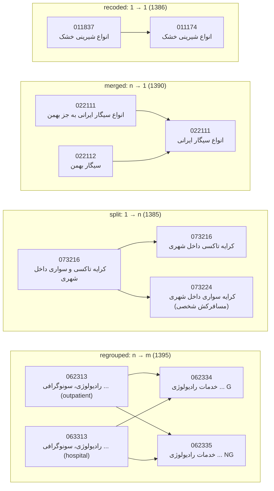
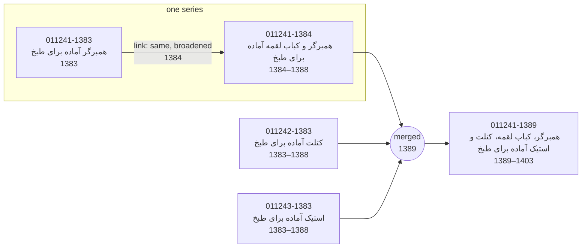
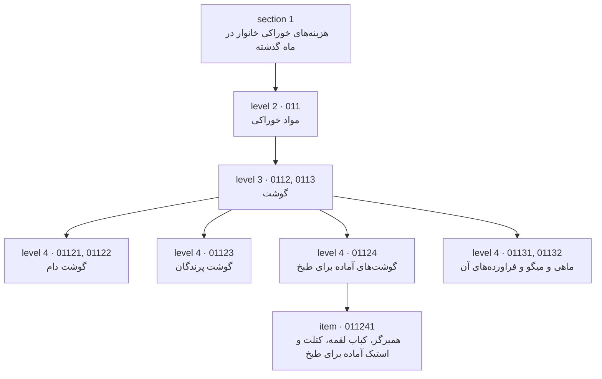
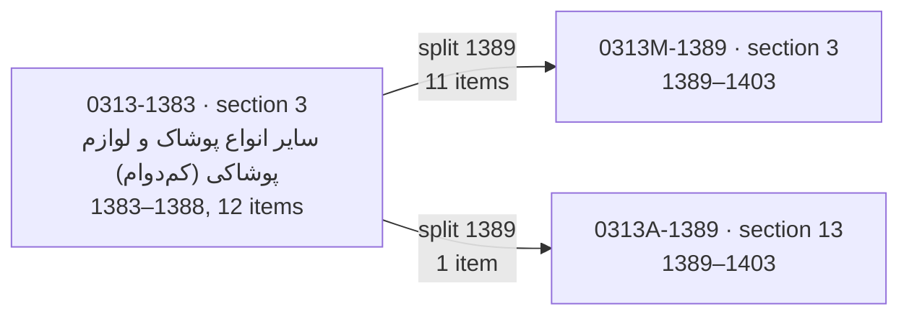

# Methods

How the questionnaires are corrected, how items are matched across years, and what the verification found.
The stages run in the order shown on the [home page](index.md#how-it-is-made).

## Terms

| Term | Meaning |
|---|---|
| **item** | one printed row of one questionnaire: an expenditure code and its description, e.g. `011241` همبرگر آماده برای طبخ in 1383 |
| **section** | a numbered part of the questionnaire, e.g. section 1, food bought in the past month; section 13, purchases in the past 12 months |
| **group** | a header printed above items (levels 2–4), followed across years; its id is its code and first year, e.g. `01124-1383` |
| **chain** | one code with one label, followed while both stay the same; its id is its code and first year, e.g. `011241-1384` |
| **link** | joins two chains that are the same item (`same`: reworded; `recoded`: new code); always one chain to one |
| **series** | chains joined by links: one item followed for as long as it can be compared on its own |
| **relation** | a merge, split or regrouping: ends a set of series and starts another |
| **group link** | how two groups relate, read from where their items went (`continued`, `split`, `merged`, …) |
| **decision** | who settled a link, relation or group link (`decided_by`): the code, a row in `curated/`, or nobody yet (`open`) |

## Corrections

`curated/2_corrected/corrections.csv` lists the errors in the questionnaires themselves,
one row per fix, each with its evidence:

| Column | Meaning |
|---|---|
| `year` | questionnaire year |
| `action` | `recode` (set an item's expenditure code), `retext` (set its description), `delete` (remove an item, with any group header left empty), `add_section` (copy a section missing from the PDF from another year), or `recode_header` / `retext_header` (set a group header's code or description; its level follows the code) |
| `expenditure_code`, `description` | the item as printed (for a header: its code as in `1_extracted`, e.g. `062 M`); the description tells two rows apart when a code is printed twice |
| `value` | the corrected code or text (for `add_section`: the source year, with the section number in `description`) |
| `reason` | evidence: neighbouring years, the raw data |

The {{ corrections.total }} corrections, all in {{ corrections.years }}, are of a few kinds:

- **Code typos:** the 1386 imputed-rent items printed under 0412 instead of
  0421/0422, and 0144 for 0411, 0341 for 0431, 0736 for 0735 that year;
  102216 for 103116 in 1384.
- **Labels in the wrong row:** two 1386 descriptions copied from the row
  above, and labels whose end was printed in the next row (093124/093125 in
  1386–1389, 123215/123216 in 1386).
- **Table labels read into a description:** a column or cell label such as
  `مبلغ رهن (ریال)` (042212, 1383–1385), and two more in 1386 and 1387.
- **Cut-off endings:** three section 14 labels (34170, 34250, 34261) in
  1383–1384.
- **A missing section:** section 2 (tobacco), whose page is blank in the
  1383 PDF, is copied from 1384 without 023111, which no household reports
  in 1383.
- **Group headers:** `062 M` printed for `0562 M` (1386), the dental header
  0622 printed with the label of 0621 (1386), and `124 M` printed as
  `1241 M` (1388–1390).

After the listed fixes every description is brought to one punctuation
style (`utils.tidy_punctuation`), {{ labels.punctuation }} descriptions in all:

- "،", "؛", ":", "؟", "!" attach to the word before them and are followed by
  one space: `آرد ، رشته ،غلات` → `آرد، رشته، غلات`;
- a Latin comma between words becomes "،" (`1,000` stays);
- a repeated mark is written once: `دیس،،` → `دیس،`;
- the conjunction و after a ZWNJ becomes its own word: `وسایل‌و لوازم` → `وسایل و لوازم`;
- an opening bracket has one space before it and none after, a closing one
  none before and one after: `نان ماشینی( لواش )سنگک` → `نان ماشینی (لواش) سنگک`;
- two or more dots, spaced or not, become `...` with a space before it
  (except after an opening bracket) and before a following word:
  `و. . .` → `و ...`, `و...وسایر` → `و ... وسایر`;
- a Persian word and a number get a space between them: `در12ماه` → `در 12 ماه`,
  `پژو405` → `پژو 405` (Latin `MP3` stays);
- a slash between words gets a space on each side: `دبیرستان/ متوسطه` →
  `دبیرستان / متوسطه` (`1/2` stays).

The same step applies the spelling rules of the Academy of Persian Language
and Literature that need no word list (`utils.standard_spelling`):

- the suffix ی after a vowel is written یی, not ئی: `دمپائی` → `دمپایی`,
  `روستائیان` → `روستاییان`, `هوائی` → `هوایی`; only at the end of a word or
  before ان / ها, so loanwords keep theirs (`گازوئیل`, `موزائیک`).

A rule replaces a list of words: this one made 15 rows of `spelling.csv`
unnecessary.

Then `curated/2_corrected/spelling.csv` fixes spellings that recur across rows and
years, applied to every description in file order:

| Column | Meaning |
|---|---|
| `find` | the wrong form (may be several words), as it reads after the punctuation rules; ZWNJs are ignored, so `شدهباشد` also finds `شده‌باشد` |
| `replace` | the right form |
| `match` | `word`: whole words only (`بجز` does not touch `بجزروانی`); `text`: anywhere in the label |
| `years` | empty for all years, or years and ranges: `1386`, `1383-1385 1390` |
| `reason` | why |

Its {{ spelling.total }} rows change {{ labels.spelling }} descriptions (it had 1,069 before the hazm
suggestions below took over 672 mechanical ones: glued words, plurals,
compounds, ZWNJs):

- typos (`دیبرستان` → `دبیرستان`, `رایو` → `رادیو`, `کارت کدملی` → `کارت ملی`),
  one spelling per word (`بجز` → `به جز`, `جابجایی` → `جابه‌جایی`, `پینگ‌پنگ`,
  ی preferred over ئ where both are in use: `ویدیو`, `آینه`, `تزیینی`);
- a و glued to the next word (`وپلاستیکی` → `و پلاستیکی`), words glued
  together or joined by a stray ZWNJ (`لباسزیر` → `لباس زیر`,
  `پزشک‌متخصص` → `پزشک متخصص`), following how the questionnaires
  themselves usually write the pair;
- ZWNJs that standard spelling requires: plural `ها`/`های`, `ه` + `ای`, `می`;
- compounds written with a ZWNJ where the questionnaires write them joined
  (`ثبت‌نام`, `سیب‌زمینی`, `پاک‌کن`); compounds they always write spaced stay
  spaced (`سی دی`, `پرداخت شده`). `--check` lists how many descriptions each row
changed, and the run warns about rows that match nothing.

**Spelling suggestions from hazm.** `spelling.csv` only fixes what someone
listed. `spelling.py` looks for the rest: it reads every label as it stands
after the corrections, the punctuation rules and `spelling.csv`, checks each
word against the word list of [hazm](https://github.com/roshan-research/hazm)
(about 194,000 words with their frequency in a large corpus), its stemmer and
the questionnaires' own words, and writes what it finds to
`output/2_corrected/spelling_suggestions.csv`:

| `kind` | What it finds | Example |
|---|---|---|
| `plural` | a plural without its ZWNJ, joined or spaced, whose stem is a word and which is no word of its own; after a letter that does not join (`ا د ذ ر ز ژ و`) no ZWNJ is needed, so `کالاهای` stays and `نما ها` becomes `نماها` | `سبزیهای` → `سبزی‌های`; `تنها` stays |
| `he_ye` | `ه + ای` without the ZWNJ: spaced, or joined when `Xه` is far more common than `X` | `پارچه ای` → `پارچه‌ای`, `جادهای` → `جاده‌ای` |
| `prefix` | the verb prefix `می` / `نمی` spaced | `می شود` → `می‌شود` |
| `compound` | two words whose joined form is a common word in hazm (the second need not be a word of its own: `طبقه‌بندی`), also with a suffix on the second (`اجاره بهای` → `اجاره‌بهای`); applied on its own, but never across `و`, `در`, `که`, `برای` …, and a verb phrase (`… شده`, `قابل …`), which hazm's corpus also joins, applies only when the printed questionnaires write it joined somewhere. A word written joined that hazm lists only with a ZWNJ (`حشرهکش` → `حشره‌کش`) gets it when the questionnaires write it apart somewhere (hazm's corpus puts a ZWNJ in many words written joined, such as `دست‌مال`). A compound hazm lacks (`تخم‌مرغ`, `سرمایه‌گذاری`, `کم‌دوام`) still needs a row in `spelling.csv` | `ثبت نام` → `ثبت‌نام`, `اسباب بازی` → `اسباب‌بازی`; `خریداری شده` waits for review |
| `broken` | a word split by a space: joined it is a common word, and one piece is no word | `ا نواع` → `انواع` |
| `glued` | words written as one, or joined by a stray ZWNJ (a `و` glued to a common word is cut even when hazm lists the glue too, if the word is ten times as common: `وکیف` → `و کیف`): every way of cutting it into words is scored by how common the words are and how few, and a cut the questionnaires write elsewhere wins; a glue the questionnaires repeat every year is cut only around a joining word (`و`, `در`, `سایر`, `نظیر` …) or as they write the phrase elsewhere, so compounds written joined (`لباسشویی`) are kept; in such a glue each ZWNJ is judged on its own: it stays before a suffix, after `می`, in a compound hazm knows, or between two pieces the questionnaires write as a word of their own (`اجاره‌بهای`, `کم‌دوام`), and is a space elsewhere (`حق‌بیمه‌های‌غیردرمانی` → `حق بیمه‌های غیردرمانی`) | `پودرپیاز` → `پودر پیاز`, `دروپنجره` → `در و پنجره`, `هزینه‌هایپرداختی` → `هزینه‌های پرداختی` |
| `typo` | a rare non-word one letter away from a common word with the same first letter | `رایو` → `رادیو` |
| `years` | an item that reads with the same letters but other spacing or ZWNJs in other years: every way the labels write those letters is counted (on the labels as the other suggestions leave them) and the form written most wins, but a form with a word hazm does not know never beats one without; applied on its own only when every other form has such a word, since a count follows how long a questionnaire kept a wording, not which is right | `سایرحق` → `سایر حق`, `وآب` → `و آب`; `موتور سیکلت` → `موتورسیکلت` waits for review |

Each row has `find`, `replace`, `kind`, `apply`, `uses` (occurrences),
`labels`, `years`, the `evidence` (the hazm frequencies behind it) and an
`example` label. `apply` is `yes` when the build applies the suggestion on
its own: plural and broken suggestions on common words, and glued words cut
into common words where the best cut clearly beats the next, and `years`
suggestions whose other forms all hold a word hazm lacks. It is `no` for
the rest, for every `he_ye` (`فرآوردهای` may be a plural that lost an `ه`) and
for every typo, since a rare word may be a name or a term hazm lacks.

`curated/2_corrected/spelling_suggestions.csv` overrides it, one row per
suggestion: `find`, `decision` (`confirm` applies it, `reject` blocks it,
`change` applies `replace` instead) and `reason`. A decision whose `find` is
no longer suggested is reported as stale, and a test fails on it. The build
applies the accepted suggestions after `spelling.csv`, so a row there always
has the last word.

hazm is an optional dependency, needed only to regenerate the file (it needs
Python 3.12 or 3.13); the build reads the file and runs without it:

```bash
uv run --python 3.13 --extra hazm python -m hiesir_codebook.correction.spelling
```

Regenerate after changing the corrections or `spelling.csv`; a test (run where
hazm is installed) checks that the file is up to date. On the current labels
it makes {{ suggestions.total }} suggestions, of which the build applies
{{ suggestions.applied }}, changing {{ labels.suggestions }} descriptions. A row in `spelling.csv` is only worth keeping when the
suggestions do not already produce its result: removing the 672 rows they
reproduce left every label unchanged.

**Label check.** After the corrections, the build lists in
`reports/label_check.csv` what may still be misspelled, for review; it changes
nothing, and a decision goes to `spelling.csv`. An `unknown` row is a word hazm
does not know (nor as a plural, with a suffix, or as a ZWNJ compound of known
words); most are right (`لیزیک`, `بتادین`), some are glued (`جانفتی`). Its
`other` column gives how other years write the same letters for the same code,
when that is all known words (`سایرحق` → `سایر حق`). A `variant` row is a code
whose label has the same letters but other spacing or ZWNJs in other years
(`سرو صورت` / `سر و صورت`): `find` is the form of the fewer years, `other` that
of the most, and either may be right. The `unknown` rows need hazm:

```bash
uv run --python 3.13 --extra hazm python -m hiesir_codebook.correction.check
```

`--check` tests both against the household occurrence table:

- each correction: a recoded item's new code must be reported by households
  that year, a deleted item's code must not be, and every item copied into a
  year must be reported in it;
- each corrected questionnaire: a code that households report but the
  questionnaire lacks, or a code printed twice, points to a typo or an
  extraction miss.

All corrections are backed by the data, and every year from 1382 to 1403
passes. The occurrence tables are in git, so a test runs this check in CI.

The structure check (`python -m hiesir_codebook.correction.structure`) needs
no data: from the CSVs alone it finds codes printed twice, sub-codes or
sections out of order, headers or items without text, malformed codes, and
items that their header's code does not cover. The corrected questionnaires
have none. Some headers are printed that way: under `06312` (specialist
hospitals) the items run on as `0631 21`–`0631 36` with no header of their own.
`curated/2_corrected/header_exceptions.csv` accepts these (header, item code,
years, reason: what the PDF shows); a row that no longer accepts anything is
reported as stale. In `output/1_extracted/` the check finds exactly the print
errors that `corrections.csv` fixes (1386: 041211–041213 and 073611 printed
twice, the header 062 M; 1384: 102216).

## Matching items across years

`output/3_items/` links each item through the 1383–1403 questionnaires as a
*series*: the same thing asked about year after year, even when its wording
changes slightly, its code changes, or it is missing from a year.

```bash
uv run python -m hiesir_codebook.linking.chains      # stage 1: output/2_corrected/ -> output/3_items/chains.csv
uv run python -m hiesir_codebook.linking.relations   # stage 2: chains.csv -> output/3_items/links.csv, relations.csv
```

Matching runs in two stages.

**Stage 1, chains.** A *chain* is one expenditure code with one label,
followed from year to year while both stay the same (labels that differ only
in spacing, ZWNJ, punctuation, hamza or digit style count as the same). Any
other label change, or the code disappearing for more than two
questionnaires, starts a new chain. So every chain has one code and one
text, and every item of every year belongs to exactly one chain.
`chains.csv` has one row per chain: `chain_id` (code and first year, e.g.
`011114-1387`), `section`, `expenditure_code`, `first_year`, `last_year`,
`missing_years`, `text`.

**Stage 2, links and relations.** A relation joins a *set* of earlier
chains to a *set* of later chains; the shape gives the kind:

| `relation` | Shape | Example |
|---|---|---|
| `same` | 1 → 1, same code | برنج چمپا و آشی → برنج آشی |
| `recoded` | 1 → 1, new code | شیرینی خشک: 011837 → 011174 (1386) |
| `merged` | n → 1 | باغبانی + سرایداری + میراب → one item (1386); 21-inch + other TVs → all TVs (1390) |
| `split` | 1 → n | خدمات آمبولانس → G / NG (1395) |
| `regrouped` | n → m | added by hand, e.g. the 1395 dental items |

One example of each shape (codes and labels as printed):



The two families do different jobs, so they are kept in separate files:

- **Links** (`same`, `recoded`; always 1 → 1) *continue* an item. The
  chains a link joins are one series, and the question to verify is how the
  label's scope changed. `links.csv` has `link_id` (`L0001`…),
  `from_chain`, `to_chain`, `relation`, `detail` (`minor`,
  `label_broadened`, `label_narrowed`, `label_reworded`, or empty when the
  label is the same), `year` (of the change), `score`,
  `decided_by`, `verified`, `note`, and both texts for reading.
- **Relations** (`merged`, `split`, `regrouped`) *end* series and start
  others. The question is which chains belong on each side.
  `relations.csv` has the same columns, with `relation_id` (`R0001`…) and
  `from_chains` / `to_chains` (chain ids separated by spaces). A chain that
  goes on with its label unchanged can appear on both sides of a merge or
  split.

The ready-to-cook hamburger shows both at work. Its first label is printed
only in 1383; in 1384 it adds کباب لقمه, a link (`same`, broadened) that
keeps one series. In 1389 the cutlet and steak items stop and the hamburger
label takes them in: a merge (`R0003`) ends three series and starts one.
From 1389 the hamburger alone has no match in 1388; the sum of the three
does.



Both are found in one pass, because a merge is found by extending a link.
They must agree: a chain has at most one link onward and one link into it,
and a chain that a merge, split or regrouping ends (or starts) has no link
onward from it (or into it), unless it appears on both sides. The build
reports any breach, and a test fails on it.

The code finds the 1 → 1 relations within a code, recodings (a chain that
ends and a similar one that starts the next year under a new code), merges
(an ending chain whose label lives on in another; a "سایر X" item that
becomes "X" while the rest of its group vanishes), and splits (a new chain
whose label was part of an older one; an item asked for all providers that
becomes a G / NG pair).

When a code's new label is unrelated, the code was reused for another
item. That is no link, so nothing goes into `links.csv`; the {{ code_reuse }}
pairs (for example 053125: انواع آبگرمکن گازی → کولرگازی) are listed in
`reports/code_reuse.csv` for review.

**Who decides.** Every link, relation and group link has a `decided_by`
column:

| `decided_by` | Meaning |
|---|---|
| `code` | the code finds it and is sure: no row in `curated/` |
| `curated` | a row in `curated/` decided it; `verified` says how (`confirmed`, `changed`, `added`, `rejected`) |
| `open` | the code found it but is not sure, and nobody has decided yet |

A 1 → 1 relation is *definite* (`decided_by` `code`) when both labels carry the same content words, so only punctuation,
the conjunction (`،` / `و`), word order, spacing, generic words (`انواع`)
or "etc." markers (`و نظایر آن` / `و ...`) differ: `جگر، دل، قلوه` →
`جگر، دل و قلوه`. Every other relation, and every merge, split or
regrouping, needs a check. Everything is now settled: of {{ links.total }} links, {{ links.code }} are
definite and `curated/3_items/links.csv` decides the rest ({{ links.confirmed }} confirmed, {{ links.changed }}
changed, {{ links.rejected }} rejected, {{ links.added }} added); `curated/3_items/relations.csv` decides all {{ relations.total }}
merges, splits and regroupings ({{ relations.confirmed }} confirmed, {{ relations.rejected }} rejected, {{ relations.added }} added).

Decisions go in `curated/3_items/links.csv` and `curated/3_items/relations.csv`, one row per
link or relation, named by its chains:

| Column | Meaning |
|---|---|
| `from_chain`, `to_chain` (links.csv) | one chain id each |
| `from_chains`, `to_chains` (relations.csv) | the chains of each side, ids separated by spaces |
| `decision` | `confirm` (right as found), `reject` (not related this way), `change` (right chains, use `relation`/`detail` instead), or `add` (a relation the code missed, e.g. a regrouping) |
| `relation`, `detail` | for `change` and `add` |
| `note` | why |

The 1 → 1 decisions were checked against the household occurrence table
(`data/commodity_code_occurrence_1383-1403.csv`). The note gives the
households reporting the old code in the year before the change and the new
code in the year of the change, as a ratio relative to the other codes of the
same group, so that survey-wide swings such as 1387 or the 1399 COVID year
cancel out. It also says whether that ratio fits the scope change: a
broadened label should not lose many households, and a narrowed one should
not gain many. Counts under 100 are too few to tell. Where the
label reading was wrong, the row is a `change`. Dropping a qualifier or an
exclusion (`در منزل`, `ساخت داخل`, `به جز بهمن`) broadens an item, and
adding one (`ذرت` → `ذرت شیرین`) narrows it. The comparison counts words, so
it reads these the other way round.

`relations` computes this evidence for every relation on each build and
writes it to `reports/relation_evidence.csv`, with the columns
`before_year`, `before`, `after`, `group`, `ratio` and `verdict` (`fits`,
`does not fit`, `too few`, `no data`). It also prints the verdicts of the
links and relations still to verify. A test checks that the evidence quoted
in the curated notes is still what the code computes.

Merges and splits need a different yardstick, because the table counts
households, not purchases: a household that reported two codes that are
later merged counts once afterwards. So after a merge the count lies between
the largest source and the sum of the sources. Before a split, the source
lies between the largest target and the sum of the targets. The evidence
gives this range (`expected x0.32-1.67`). A sibling code only enters the
group comparison when one chain asks it in both years, so a code reused for
another item does not distort it.

What the verification found:

- **Wrong direction.** Dropping a qualifier broadens an item, adding one
  narrows it, and compare reads both the other way round (22 of the {{ links.changed }}
  changed links, see above).
- **"Outside the home" items (1386).** 062315, 062321, 062323, 062328 and
  062331 ended when their "at home" twins dropped `در منزل`. These are
  merges, not broadenings: vaccination at home (233 households) plus
  outside (3,520) became one item (3,909).
- **Hospital services (1386).** Each hospital type's seven cost items
  (admin, bed, food, emergency, ambulance, drugs, equipment, 063411–063447)
  became one item (063418/28/38/48). The code had sent the drug items to
  special-disease drugs and the admin items to the urine test.
- **The 1395 health redesign.** Outpatient and inpatient care were
  regrouped and split by provider (G/NG): visits, dental care, radiology,
  lab tests, paramedical services, dialysis and chemotherapy, medical
  devices and inpatient bills. The visits at hospitals (0631, 0633) joined
  the outpatient items. These are `add`ed regroupings. Medicines split into
  with and without a prescription, and addiction treatment by place.
- **New items mistaken for splits.** When the old item held its households
  and the new one is not carved out of it, the split is rejected: bread
  dough (011166) is not the yeast of 011934; children's sportswear (031262)
  and other non-durables (056154) are new.
- **Left out of merges.** The tonsil and appendix surgeries (1386),
  hearing-aid repair (1386) and game meat 011219, which went to 011221 (it
  added `شکار`), not to the game birds.
- **Broadenings that were merges.** An item whose label drops an exclusion
  or a qualifier, or adds words, just as another item that those words name
  stops being asked, has absorbed that item: «انواع سیگار ایرانی به جز بهمن»
  plus «سیگار بهمن» became «انواع سیگار ایرانی» (1390), and in 1386 the
  foreign-made toothbrushes, toothpaste and face cream joined the domestic
  ones, filming joined photography, recorded tapes and CDs joined the blank
  ones, and in 1392 outpatient surgery added «کاشت مو» as the hair-transplant
  item of section 12 ended. 21 links read as broadenings were such merges
  (18 merges and two regroupings of three items into two: the 1390 bicycles,
  and in 1384 the toy bicycles, tricycles and walkers of 093115, whose
  tricycles went to the 16-inch bicycle and whose walkers to the baby gear
  of section 12). The
  household counts agree in every case, and decide two: read as broadenings,
  recorded CDs and 28-inch bicycles would have tripled. Two narrowings were
  splits the same way round: «کرایه تاکسی و سواری داخل شهری» dropped «سواری»
  as «کرایه سواری داخل شهری (مسافرکش شخصی)» started (1385), and the
  electric-blanket item dropped the thermometer and hot-water bottle as
  «تب‌سنج، کیسه آبجوش، کیسه یخ» started (1389). A search of every broadened
  or narrowed link for an item that ended or started beside it, under words
  the label gained or lost, finds no others in its group; the 1384
  regrouping crosses groups and sections, and was found by reading the labels.

Where the counts still do not fit, the note says why, for example: landline
phones declining as mobiles spread; internet cafés closing under COVID in
1399; reports moving between insurance codes; a survey-wide jump with the
label unchanged (125112 in 1384, 127119 in 1387). Three notes leave the
cause open: 053312 halving in 1390, the 1386 public surgery fees halving, and
dialysis and chemotherapy rising from 36 to 207 households in 1395.

Each file only takes its own kind: a `change` or `add` with `merged` in
`curated/3_items/links.csv`, or with `same` in `curated/3_items/relations.csv`, is an
error. To change the chains of a relation, reject it and add the right one;
when a merge replaces a link (the "outside the home" items), reject the link.
`links.csv` and `relations.csv` record each decision in `verified` (`confirmed`,
`rejected`, `changed`, `added`) and the `note`; rejected relations stay in
the file but later stages ignore them. A decision whose relation is not
found (for example after a label correction merged two chains) is reported
as stale, and the tests fail until it is updated. The rows still to check
are those with `decided_by` `open`.

**How labels are compared** (`compare.py`, used by both stages). Two
descriptions are compared with spacing, ZWNJ, punctuation, hamza and digit
style ignored, then by character similarity (typos, joined words) and by
overlap of content words (scope changes). The result is one of `same`,
`minor`, `broadened`, `narrowed`, `reworded` or `different`. A `reworded`
pair must still share its head noun, so آبگرمکن گازی → کولرگازی counts as
`different`.

**Collapsing into the residual item.** A group can collapse into its
residual item: in 1390 "سایر انواع تلویزیون رنگی داخلی" (other domestic
colour TVs) became "انواع تلویزیون رنگی داخلی" (all of them) while the
21-inch item disappeared. When a "سایر X" item becomes "X" and related items
of its code group vanish that year, they are all merged into the new chain
(six cases: TVs and new cars in 1390, collections and surgery fees in 1386).

**Providers.** Many health services are asked once per kind of provider:
"(دولتی)" / "(خصوصی)" in 1383–1394, and "G" / "NG" from 1395. G covers
centres owned by the medical universities and NG all other providers,
including social security, the armed forces, private and charity, so NG
covers more than خصوصی did. The qualifier stays in the text but is left out
of the comparison, and a chain only links to an item for the same provider:
دولتی → G, خصوصی → NG. An item asked for all providers that becomes a G/NG
pair is a split (e.g. خدمات آمبولانس in 1395).

## Groups across years

The questionnaire prints up to three levels of headers between a section and
its items. In 1403, the hamburger item sits under its section and three headers:



`groups.py` follows the group headers (levels 2–4, above the items) the
way the chains follow items:

- A **group** is one header, its section and its code as printed (`0111`,
  `01121, 01122`, `0314 M`), for as long as it is printed, skipping at most
  two questionnaires. A changed label keeps the group; `groups.csv` shows
  the latest. A group is identified by its code and first year:
  `0111-1383`, `01121+01122-1383`, `0314M-1389`.
- Every item of every year sits under one group per level.
  `4_groups/members.csv` (`year`, `expenditure_code`, `level_2`, `level_3`,
  `level_4`) is the crosswalk for summing items into groups.
- Where the items go tells how groups relate. When an item continues to the
  next year (in its chain, through a link, or through a merge, split or
  regrouping that is not rejected) under another group at the same level,
  the two groups are linked in `4_groups/links.csv`:

| Relation | Meaning |
|---|---|
| `continued` | the old group ends, the new one starts and takes its items: the same group under another code (`112` → `112 M` in 1397, `01192, 01193` → `01192, 01193, 01194`) |
| `split` | the old group ends and its items go to several new ones (`0314` → `0314 M` and `0314 A` in 1389) |
| `merged` | several old groups end in one new group (`05111`, `05112`, `05113` → `05117` in 1386) |
| `regrouped` | both at once |
| `moved` | items moved between groups printed before and after: a reorganisation, or a wrong item link |

For example, in 1389 the semi-durable clothing group `0313` is printed in two
parts, and the items say which went where (see the `M` and `A` suffixes below):



The code decides a group link (`decided_by` `code`) when three things hold:
it is not `moved`; the codes are related (one shares a code with the other,
or starts it: `0313` → `0313 M`, `096` → `0961`); and the labels match the
way item links must: identical, or differing only in spacing, ZWNJ,
punctuation, the conjunction (`،` / `و`), word order, generic words or
"etc." markers (`روغن‌ها و چربی‌ها و کره` → `روغن‌ها، چربی‌ها و کره`). The
others are `open` until a row in `curated/4_groups/links.csv` decides
them (`from_group`, `to_group`, `decision`, `relation`, `note`; the
decisions of `links.csv`). The 1384 split of `هزینه آموزش` into
`هزینه آموزش ابتدایی و پیش دبستانی` and the other levels is one of them:
the codes are related but the labels narrowed. All {{ groups.links.curated }} such links are
decided ({{ groups.links.confirmed }} confirmed; one `split` changed to `continued`, as only one of
its items left for another group; {{ groups.links.rejected }} rejected: a regrouping links every
source with every target, so the 1384 baby gear and 16-inch bicycle seemed
to swap groups). Two more `moved` links came from the
1388–1390 questionnaires, which print the level-2 header `124 M` as
`1241 M`; `curated/2_corrected/corrections.csv` restores the code.
A `moved` link that comes from a wrong item link is fixed in `links.csv`
or `relations.csv`, not here. `items` counts the item chains that moved,
`from_items` and `to_items` the items under each group that year, and
`item_chains` lists the chains.

**The `M` and `A` suffixes** mark a COICOP group whose items are divided
between the two recall periods: `M` in sections 1–12 (expenditure "in the
past month") and `A` in section 13 (purchases "in the past 12 months"). In
every year from 1383 to 1403, a group code printed in both parts carries `M`
in the first and `A` in the second, and a group asked in only one part has no
suffix. A few suffixed groups have no partner in the other part: `044 M`
(1384), `063 A` / `0631 A` (1395) and `112 M` /
`1120 M` (1397 on).
The suffix does not mark durability. Both `0313 M` and `0313 A` are labelled
کم‌دوام (semi-durable), and the `A` side also holds services such as
driving lessons (`072414`) and nursery fees (`124113`). It holds the
expenses households make rarely and remember over a year. The questionnaires
print no legend for the letters, so this reading comes from where the codes
appear. When `M` and `A` groups are first printed, the old group shows up as
a `split` (`0313` → `0313 M` and `0313 A` in 1389).

## How it works

The code lives in three folders under `src/hiesir_codebook/`, one per kind of
work: `extraction/` (PDFs to `output/1_extracted/`), `correction/` (to
`output/2_corrected/`) and `linking/` (chains, links, relations and groups
across years, to `output/3_items/` and `output/4_groups/`).

- `pdf_text.py` rebuilds right-to-left text from glyph positions. Glyphs without
  a Unicode mapping (1382) are decoded through their glyph names. A gap wider than
  0.15 of the font size is a space. A ZWNJ is recovered where a joining letter is
  drawn in its final or isolated form and touches the next letter (`چراغ‌خوراک‌پزی`);
  fonts that map each letter form to its own code map the isolated form to the
  plain letter, so there a plain letter counts as isolated.
- `glyph_db.py` repairs fonts whose ToUnicode map is wrong (1395, 1396, 1399,
  1402: بخش extracts as لاوش). Each glyph's outline is hashed and looked up in
  `src/hiesir_codebook/extraction/data/glyph_db.json` (tracked), which is built from the clean PDFs. A font is treated as
  broken when its ToUnicode map disagrees with the database: clean PDFs agree
  100%, broken fonts disagree on 0.8% or more. A text span names its font
  without the subset prefix, and a page often embeds two subsets under one
  name (a few digits, and the letters); the span's font is the one that has
  outlines for its glyphs. The database keeps each glyph's
  form as the clean PDFs' shaped fonts map it (ﻬ medial, ﻪ final, ه isolated), so
  the ZWNJ recovery works in the repaired years too (میوه‌گیری). To rebuild the database:
  `uv run python -m hiesir_codebook.extraction.build_glyph_db`. The extraction
  stops with an error when the database is missing, or knows under 50% of a
  PDF's glyph outlines (0.94–1.0 in 1383–1403, 0.82 in 1382): then the hashes no
  longer match, for example after a fontTools change, and broken fonts would go
  unnoticed. A unit test pins the hash of a known outline for the same reason.
- `parse.py` finds code lines and attaches wrapped description lines to them,
  using the table rules and column borders.
- `layout.py` holds what a new year may need changed: the distances within a
  table row (in points; not relative to the font size, since the 12 pt text of
  1382–1385 sits in rows as tall as the 11 pt text of later years, and scaled
  distances pulled column headings into descriptions there), the field labels
  printed inside description cells, and the print quirks the parser repairs,
  each with the years it is seen in: a stray comma inside a code (1384–1385),
  a header code list wrapped onto the next line or split around its text, a
  sub-code above its code in a tall cell (1391–1394), an item continued on
  the next page, source-code notes and field labels left out.
- Each extraction also writes `output/1_extracted/report_<year>.csv` (tracked, so a change shows in the diff): the text it left
  out (not aligned to its column border, no code line near it, a code
  continuation with no header, a page number, a stray two-digit header, text
  before the first section, a page whose text is turned sideways), the glyphs it could not read (a broken font's
  glyph missing from the database, an unmapped glyph without a usable name)
  and every quirk repair it made (`repaired: ...`, `left out: ...`),
  one row per reason and text with its count and pages. A test fails when a
  repair turns up in a year `layout.QUIRKS` does not list for it: look at the
  PDF, then add the year there. Most rows are table
  headings repeated on every page; the rest is what to look at in a new year.
  Pages turned sideways (a /Rotate, or text drawn vertically on an upright
  page) are not read: glyph boxes are read unrotated, so their text would fall
  apart into letters. In every year they are the landscape income tables after
  the expenditure part.
- `correct.py` applies `curated/2_corrected/corrections.csv` and `curated/2_corrected/spelling.csv`
  to `output/1_extracted/` and checks the result against the household occurrence
  table. `spelling.py` writes the spelling suggestions from hazm's
  dictionary that `correct.py` applies last.
- `compare.py` compares two descriptions (`same`, `minor`, `broadened`, ...)
  and handles provider qualifiers; shared by the matching stages.
- `chains.py` builds the chains (matching stage 1), `relations.py` links them
  (stage 2), and `groups.py`
  follows the group headers.
- `pdfs.py` lists the PDFs in `data/pdfs.csv` (name, year, form, size,
  SHA-256), downloads them from the release and checks a copy against it.
- `occurrence.py` reads the household occurrence tables
  (`data/commodity_code_occurrence_*.csv`) for `correct.py` and `relations.py`.
- `structure.py` checks the corrected CSVs from the CSVs alone (see
  [Corrections](#corrections)).
- `utils.py` holds the Persian text normalisation helpers, usable on their own:
  `normalize_persian` (letters, digits, tatweel, spacing), `to_ascii_digits` /
  `to_persian_digits`, `canonical` (presentation forms → base letters),
  `normalize_visual` (fix-up for right-to-left glyph text) and `loose_key`
  (comparison that ignores spacing, ZWNJ and punctuation).
